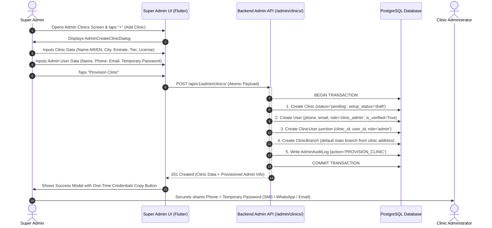
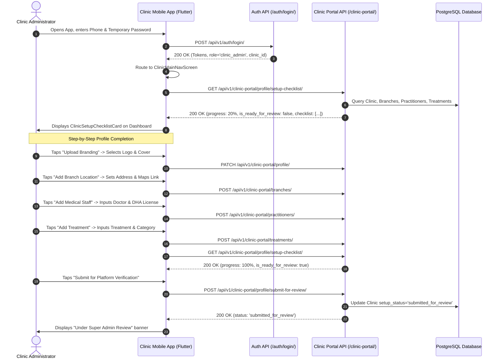
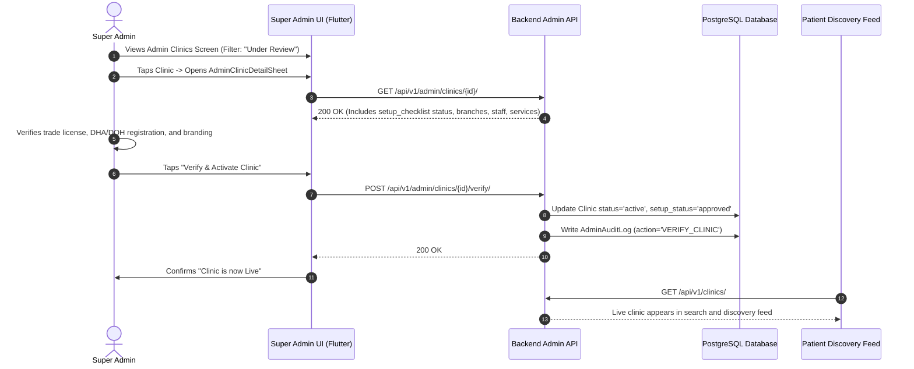
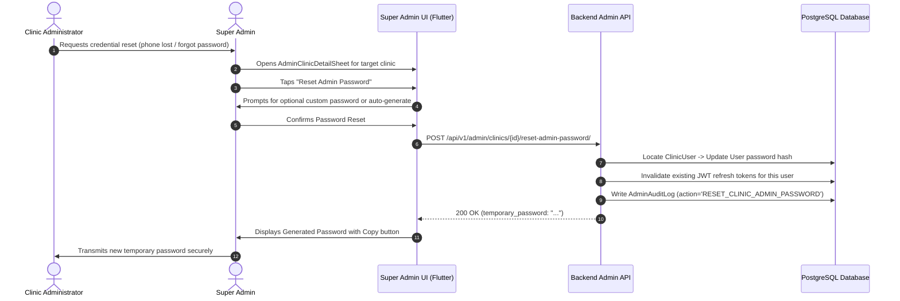

# AESTHETIC WAY — Clinic Onboarding, Provisioning & Full Lifecycle CRUD Specification

**Document Version:** 1.0.0  
**Target Architecture:** Multi-Portal Ecosystem (Super Admin, Clinic Partner, Patient Discovery)  
**Backend Framework:** Django 5.x / Django REST Framework (DRF)  
**Frontend Platform:** Flutter 3.x (iOS & Android)  
**Target Environments:** Staging & Production (`https://aestheticway.ae/api/v1/`)  
**Status:** Approved Architectural Specification  

---

## 1. Executive Summary & Production Problem Statement

### 1.1 The Production Context
In the current development environment of **AESTHETIC WAY**, clinics, medical practitioners, and treatments exist primarily because they are seeded into the database via backend administrative commands (`seed_data.py`). 

However, in a production environment:
1. Seed scripts cannot and must not be used to create real business entities.
2. In the UAE medical aesthetic and dermatology sector (regulated by the **Dubai Health Authority - DHA**, **Department of Health Abu Dhabi - DOH**, and **Ministry of Health and Prevention - MOHAP**), open public self-registration of clinics is strictly prohibited. Unverified entities must never be permitted to self-publish medical services.
3. Therefore, clinic onboarding must be **initiated and provisioned by the Super Admin**, who verifies the clinic's commercial license and healthcare facility accreditation before granting platform access.
4. Once provisioned by the Super Admin, the clinic administrator receives initial credentials, logs into the mobile app via the standard authentication screen, and is routed via their JWT role (`clinic_admin`) to the **Clinic Portal**.
5. Upon first login, the Clinic Admin is met with an empty dashboard. Without a guided onboarding checklist and setup workflow, the clinic has no clear pathway to upload their branding, define bilingual descriptions, configure branch locations, or populate their medical staff and treatment catalog.

### 1.2 Strict Product Boundaries (Non-Negotiable)
As established across all AESTHETIC WAY architectural directives:
- **NO Patient Payments / Checkout / Cart**: The platform does not process payments or collect commissions inside the app.
- **NO Booking Calendar / Time-Slot Selection**: The app does not maintain a booking calendar or doctor appointment schedule. All appointment requests are **Leads only**.
- **NO In-App Appointment Confirmation**: The required confirmation wording remains strictly:  
  *Arabic:* `"تم إرسال طلبك وستتواصل العيادة معك"`  
  *English:* `"Your request has been sent and the clinic will contact you."`
- **NO Home Services / Non-Medical Salons**: Strictly licensed, physical medical clinics only.
- **NO Raw Medical License Numbers in Patient UI**: Medical licenses and subscription tiers remain internal-only attributes.

---

## 2. End-to-End Architectural Workflow

The complete clinic lifecycle spans four distinct operational states across Super Admin and Clinic Partner roles:

```
+----------------------------------------------------------------------------------------------------+
|                                    CLINIC LIFECYCLE STATE MACHINE                                   |
+----------------------------------------------------------------------------------------------------+

     [Super Admin]
           │
           ▼
┌─────────────────────┐      Creates Clinic + Admin User
│  PENDING_PROVISION  │ ────────────────────────────────────────┐
└─────────────────────┘                                         │
                                                                ▼
┌─────────────────────┐      Logs in with Temp Password   ┌───────────┐
│  DRAFT / ONBOARDING │ ◄──────────────────────────────── │  CREATED  │
└──────────┬──────────┘                                   └───────────┘
           │
           │  Guided Setup Checklist:
           │   1. Upload Logo & Cover Image
           │   2. Fill Bilingual Description & Social/Contact
           │   3. Configure Primary & Secondary Branches (Google Maps)
           │   4. Add at least 1 Licensed Practitioner
           │   5. Add at least 1 Treatment Service
           │
           ▼
┌─────────────────────┐      Notifies Super Admin
│ SUBMITTED_FOR_REVIEW│ ────────────────────────────────────────┐
└─────────────────────┘                                         │
                                                                ▼
┌─────────────────────┐      Super Admin Approves         ┌───────────┐
│   ACTIVE / PUBLIC   │ ◄──────────────────────────────── │ REVIEWED  │
└──────────┬──────────┘                                   └───────────┘
           │
           ├──────────────────────────┐
           │ Super Admin Suspends     │ Clinic Soft-Deleted / Archived
           ▼                          ▼
┌─────────────────────┐    ┌─────────────────────┐
│      SUSPENDED      │    │      ARCHIVED       │
└─────────────────────┘    └─────────────────────┘
```

---

### 2.1 Sequence 1: Super Admin Provisions Clinic & Admin Credentials



---

### 2.2 Sequence 2: Clinic Admin First Login & Guided Setup Checklist



---

### 2.3 Sequence 3: Super Admin Verification & Public Activation



---

### 2.4 Sequence 4: Credential Recovery & Super Admin Password Reset



---

## 3. Comprehensive Gap Analysis Across All Three Portals

### 3.1 Super Admin Portal Gaps

| Feature Area | Current State in Codebase | Required Production Behavior | Priority |
| :--- | :--- | :--- | :--- |
| **Clinic Creation (`POST /admin/clinics/`)** | Missing. Endpoint router only accepts `{"get": "list"}`. `AdminClinicViewSet` does not implement `create()`. | Atomic creation of `Clinic` record, primary `ClinicBranch`, Django `User` with `role='clinic_admin'`, and `ClinicUser` membership record. | **P0 (Blocker)** |
| **Admin Credential Provisioning** | No mechanism exists to attach a user account to a newly created clinic. | Inputs for Administrator Full Name, Phone, Email, and Temporary Password; validates unique phone and email. | **P0 (Blocker)** |
| **Credential Reset Endpoint** | Missing. Super Admin cannot reset or recover clinic admin access. | `POST /api/v1/admin/clinics/{id}/reset-admin-password/` generates a high-entropy temp password, invalidates active sessions, and logs an audit record. | **P1 (Critical)** |
| **Soft-Deletion / Archival** | Missing. No `destroy()` or archive action on `AdminClinicViewSet`. | `DELETE /api/v1/admin/clinics/{id}/` soft-deletes the clinic (`deleted_at=now()`), marks `ClinicUser.is_active=False`, and cascades soft-delete to branches/catalog. | **P1 (Critical)** |
| **Verification Workflow** | `POST /admin/clinics/{id}/verify/` exists in backend, but Flutter UI has no explicit verification review sheet or pending filter. | Filter chip for `pending_review` clinics, checklist validation summary in `AdminClinicDetailSheet`, and dedicated "Approve & Activate" button. | **P1 (Critical)** |
| **Floating Action Button** | `AdminClinicsScreen` has search and tier chips, but no "Create Clinic" button. | Add luxury styled Floating Action Button (`+`) that launches `AdminCreateClinicDialog`. | **P1 (Critical)** |

---

### 3.2 Clinic Partner Portal Gaps

| Feature Area | Current State in Codebase | Required Production Behavior | Priority |
| :--- | :--- | :--- | :--- |
| **Onboarding Checklist API** | Missing. No endpoint exposes setup completion percentage or required tasks. | `GET /api/v1/clinic-portal/profile/setup-checklist/` returning structured items (branding, bio, branches, practitioners, treatments) and progress score. | **P0 (Blocker)** |
| **Empty Dashboard Experience** | `ClinicDashboardScreen` displays zeros for leads and catalog counts without guidance. | Displays prominent, collapsible `ClinicSetupChecklistCard` with progress bar, clickable step tiles, and "Submit for Review" CTA. | **P0 (Blocker)** |
| **Secondary Branch Management** | Backend has `ClinicBranchPortalViewSet` (`clinic-portal/branches/`), but Flutter `ClinicCatalogRepository` has no branch methods. | Add `getBranches()`, `createBranch()`, `updateBranch()`, and `deleteBranch()` in `ClinicCatalogRepository`, with UI in `ClinicProfileScreen`. | **P1 (Critical)** |
| **Submission for Review** | No endpoint or UI to trigger review transition from `draft` to `submitted_for_review`. | `POST /api/v1/clinic-portal/profile/submit-for-review/` validates that minimum criteria are met (logo, bio, 1 doctor, 1 service) and locks edit mode until review. | **P1 (Critical)** |
| **Status Banner** | Clinic cannot see if it is in `draft`, `under_review`, `active`, or `suspended`. | Persistent luxury banner at top of dashboard indicating current moderation status with contextual explanations. | **P2 (Important)** |

---

### 3.3 Patient Portal Gaps & Boundary Protection

| Feature Area | Current State in Codebase | Required Production Behavior | Priority |
| :--- | :--- | :--- | :--- |
| **Unapproved Clinic Isolation** | `PublicClinicSerializer` filters `status='active'`. | Ensure newly provisioned `draft` or `submitted_for_review` clinics **never** appear in search, home feed, or category listings. | **P0 (Verified)** |
| **Suspended Clinic Leads** | Flutter client disables submission if clinic status changes to suspended. | Backend validation must explicitly reject lead creation (`HTTP 403 Forbidden`) if target clinic is suspended or unapproved. | **P0 (Verified)** |
| **Google Maps Place Linking** | Server-side cached ratings supported. | In newly created clinics, validate Google Place ID syntax or provide maps URL fallback. | **P2 (Important)** |

---

## 4. Backend Engineering Specification (For Ali)

### 4.1 Database Model Extensions

#### Model: `Clinic` (`apps/clinics/models.py`)
Add setup status tracking and submission timestamps:

```python
class ClinicSetupStatus(models.TextChoices):
    DRAFT = "draft", "Draft / Onboarding"
    SUBMITTED = "submitted", "Submitted for Review"
    APPROVED = "approved", "Approved"
    REJECTED = "rejected", "Rejected"

# Add to Clinic model:
setup_status = models.CharField(
    max_length=20,
    choices=ClinicSetupStatus.choices,
    default=ClinicSetupStatus.DRAFT,
    db_index=True,
    help_text="Tracks the onboarding progress of the clinic.",
)
submitted_for_review_at = models.DateTimeField(
    null=True,
    blank=True,
    help_text="Timestamp when the clinic admin submitted their profile for Super Admin verification.",
)
onboarding_completed_at = models.DateTimeField(
    null=True,
    blank=True,
    help_text="Timestamp when Super Admin approved and published the clinic.",
)
```

---

### 4.2 Endpoint 1: Super Admin Provisions Clinic & Admin User

- **Path:** `POST /api/v1/admin/clinics/`
- **Permission:** `IsAuthenticated`, `IsSuperAdmin`
- **Description:** Atomically creates a new clinic, assigns its subscription tier and regulatory attributes, creates a Django `User` with `role='clinic_admin'`, creates the `ClinicUser` membership junction, and instantiates the main branch.

#### Request Payload:
```json
{
  "name_en": "Cosmeceutical Elite Clinic",
  "name_ar": "عيادة النخبة للتجميل الطبي",
  "city": "Dubai",
  "emirate": "Dubai",
  "address_en": "Villa 42, Jumeirah Beach Road, Jumeirah 1",
  "address_ar": "فيلا 42، شارع شاطئ جميرا، جميرا 1",
  "phone": "+97143440001",
  "whatsapp": "+971501234567",
  "email": "contact@eliteclinic.ae",
  "website": "https://eliteclinic.ae",
  "subscription_tier": "vip",
  "license_number": "DHA-FL-0098231",
  "license_authority": "DHA",
  "is_featured": true,
  "admin_user": {
    "full_name": "Dr. Sarah Al Maktoum",
    "phone": "+971509988776",
    "email": "admin@eliteclinic.ae",
    "temporary_password": "TempPassword123!"
  }
}
```

#### Response Payload (`201 Created`):
```json
{
  "status": "success",
  "message": "Clinic and Administrator provisioned successfully.",
  "clinic": {
    "id": "c7a8b9c0-1234-5678-9abc-def012345678",
    "name_en": "Cosmeceutical Elite Clinic",
    "name_ar": "عيادة النخبة للتجميل الطبي",
    "slug": "cosmeceutical-elite-clinic",
    "city": "Dubai",
    "emirate": "Dubai",
    "status": "pending",
    "setup_status": "draft",
    "subscription_tier": "vip",
    "license_number": "DHA-FL-0098231",
    "license_authority": "DHA",
    "is_active": false,
    "is_featured": true,
    "created_at": "2026-10-04T12:00:00Z"
  },
  "admin_user": {
    "id": "u1b2c3d4-5678-90ab-cdef-1234567890ab",
    "full_name": "Dr. Sarah Al Maktoum",
    "phone": "+971509988776",
    "email": "admin@eliteclinic.ae",
    "role": "clinic_admin",
    "is_active": true,
    "is_verified": true,
    "temporary_password": "TempPassword123!"
  }
}
```

#### Error Responses:
- `400 Bad Request`: Validation failure (e.g., Phone already registered to another user, invalid UAE phone format, duplicate clinic slug).
- `401 Unauthorized`: Missing or invalid token.
- `403 Forbidden`: Authenticated user is not a Super Admin.

---

### 4.3 Endpoint 2: Super Admin Resets Clinic Admin Password

- **Path:** `POST /api/v1/admin/clinics/{id}/reset-admin-password/`
- **Permission:** `IsAuthenticated`, `IsSuperAdmin`
- **Description:** Generates or applies a new temporary password for the administrator of the specified clinic, invalidates all existing active tokens, and creates an audit trail entry.

#### Request Payload:
```json
{
  "custom_password": "OptionalCustomPassword2026!"
}
```
*(If `custom_password` is omitted or empty, backend generates a secure 12-character alphanumeric password automatically).*

#### Response Payload (`200 OK`):
```json
{
  "status": "success",
  "clinic_id": "c7a8b9c0-1234-5678-9abc-def012345678",
  "admin_user_id": "u1b2c3d4-5678-90ab-cdef-1234567890ab",
  "admin_phone": "+971509988776",
  "admin_email": "admin@eliteclinic.ae",
  "temporary_password": "OptionalCustomPassword2026!",
  "message": "Temporary password reset successfully. Please securely transmit this to the clinic administrator."
}
```

---

### 4.4 Endpoint 3: Super Admin Soft-Deletes / Archives Clinic

- **Path:** `DELETE /api/v1/admin/clinics/{id}/`
- **Permission:** `IsAuthenticated`, `IsSuperAdmin`
- **Description:** Performs a cascading soft-deletion:
  1. Sets `Clinic.deleted_at = timezone.now()` and `Clinic.status = 'suspended'`.
  2. Sets `ClinicUser.is_active = False` for all linked memberships.
  3. Sets `deleted_at = timezone.now()` on all branches, practitioners, treatments, offers, and products.
  4. Records `AdminActionType.ARCHIVE_CLINIC` in `AdminAuditLog`.

#### Response Payload (`200 OK`):
```json
{
  "status": "success",
  "message": "Clinic and all associated catalog entities have been archived successfully.",
  "clinic_id": "c7a8b9c0-1234-5678-9abc-def012345678",
  "archived_at": "2026-10-04T12:15:00Z"
}
```

---

### 4.5 Endpoint 4: Clinic Portal Setup Checklist & Readiness Engine

- **Path:** `GET /api/v1/clinic-portal/profile/setup-checklist/`
- **Permission:** `IsAuthenticated`, `IsClinicPortalAccess`
- **Description:** Dynamically evaluates the clinic profile against publication requirements and calculates an onboarding readiness score.

#### Response Payload (`200 OK`):
```json
{
  "clinic_id": "c7a8b9c0-1234-5678-9abc-def012345678",
  "setup_status": "draft",
  "progress_percentage": 60,
  "is_ready_for_review": false,
  "items": [
    {
      "key": "branding",
      "title_en": "Clinic Branding (Logo & Cover)",
      "title_ar": "الهوية البصرية (الشعار وصورة الغلاف)",
      "is_completed": true,
      "route": "/clinic/profile"
    },
    {
      "key": "details",
      "title_en": "Bilingual Bio & Contact Information",
      "title_ar": "الوصف التعريفي باللغتين ومعلومات الاتصال",
      "is_completed": true,
      "route": "/clinic/profile"
    },
    {
      "key": "branch",
      "title_en": "At least 1 Active Branch Location",
      "title_ar": "إضافة فرع واحد على الأقل مع خرائط جوجل",
      "is_completed": true,
      "route": "/clinic/branches"
    },
    {
      "key": "practitioners",
      "title_en": "At least 1 Licensed Medical Practitioner",
      "title_ar": "إضافة طبيب أو ممارس مرخص واحد على الأقل",
      "is_completed": false,
      "route": "/clinic/practitioners"
    },
    {
      "key": "treatments",
      "title_en": "At least 1 Treatment Service",
      "title_ar": "إضافة خدمة أو علاج تجميلي واحد على الأقل",
      "is_completed": false,
      "route": "/clinic/treatments"
    }
  ]
}
```

---

### 4.6 Endpoint 5: Clinic Submits Profile for Super Admin Review

- **Path:** `POST /api/v1/clinic-portal/profile/submit-for-review/`
- **Permission:** `IsAuthenticated`, `IsClinicPortalAccess`
- **Description:** Verifies that all mandatory checklist items are complete. If valid, updates `setup_status` to `'submitted'` and records `submitted_for_review_at = timezone.now()`.

#### Response Payload (`200 OK`):
```json
{
  "status": "success",
  "setup_status": "submitted",
  "submitted_at": "2026-10-04T12:30:00Z",
  "message": "Your profile has been submitted for platform verification. Our medical compliance team will review your details."
}
```

#### Error Response (`400 Bad Request` if incomplete):
```json
{
  "error": "INCOMPLETE_ONBOARDING",
  "message": "Cannot submit profile. You must add at least one licensed practitioner and one treatment service.",
  "missing_items": ["practitioners", "treatments"]
}
```

---

### 4.7 Python / Django Implementation Code for Backend (Ali)

The following reference implementation provides the exact Django service and views required:

```python
# apps/admin_portal/services/clinic_provisioning.py
import secrets
import string
from django.db import transaction
from django.utils.text import slugify
from rest_framework.exceptions import ValidationError

from apps.accounts.models import ClinicRoleInClinic, ClinicUser, User, UserRole
from apps.admin_portal.models import AdminActionType, AdminAuditLog
from apps.clinics.models import Clinic, ClinicBranch, ClinicSetupStatus, ClinicStatus


def generate_secure_password(length=12):
    characters = string.ascii_letters + string.digits + "!@#$%&*"
    return "".join(secrets.choice(characters) for _ in range(length))


class ClinicProvisioningService:
    @classmethod
    @transaction.atomic
    def provision_clinic(cls, admin_user: User, data: dict) -> dict:
        admin_data = data.pop("admin_user", None)
        if not admin_data:
            raise ValidationError({"admin_user": "Administrator details are required."})

        phone = admin_data.get("phone", "").strip()
        email = admin_data.get("email", "").strip()
        full_name = admin_data.get("full_name", "").strip()
        raw_password = admin_data.get("temporary_password", "").strip() or generate_secure_password()

        if User.objects.filter(phone=phone).exists():
            raise ValidationError({"admin_user.phone": "This phone number is already registered."})
        if email and User.objects.filter(email=email).exists():
            raise ValidationError({"admin_user.email": "This email address is already registered."})

        # 1. Create Clinic Record
        name_en = data.get("name_en", "").strip()
        name_ar = data.get("name_ar", "").strip()
        base_slug = slugify(name_en)
        slug = base_slug
        counter = 1
        while Clinic.objects.filter(slug=slug).exists():
            slug = f"{base_slug}-{counter}"
            counter += 1

        clinic = Clinic.objects.create(
            name_en=name_en,
            name_ar=name_ar,
            slug=slug,
            city=data.get("city", "Dubai"),
            emirate=data.get("emirate", "Dubai"),
            address_en=data.get("address_en", ""),
            address_ar=data.get("address_ar", ""),
            phone=data.get("phone", phone),
            whatsapp=data.get("whatsapp", ""),
            email=data.get("email", email),
            website=data.get("website", ""),
            subscription_tier=data.get("subscription_tier", "basic"),
            license_number=data.get("license_number", ""),
            license_authority=data.get("license_authority", "DHA"),
            is_featured=data.get("is_featured", False),
            status=ClinicStatus.PENDING,
            setup_status=ClinicSetupStatus.DRAFT,
        )

        # 2. Create Primary Branch
        ClinicBranch.objects.create(
            clinic=clinic,
            name_en="Main Branch",
            name_ar="الفرع الرئيسي",
            address_en=clinic.address_en,
            address_ar=clinic.address_ar,
            city=clinic.city,
            phone=clinic.phone,
            is_main_branch=True,
            is_active=True,
        )

        # 3. Create Admin User
        user = User.objects.create_user(
            phone=phone,
            password=raw_password,
            full_name=full_name,
            email=email if email else None,
            role=UserRole.CLINIC_ADMIN,
            is_active=True,
            is_verified=True,
        )

        # 4. Create Clinic Membership Junction
        ClinicUser.objects.create(
            user=user,
            clinic=clinic,
            role_in_clinic=ClinicRoleInClinic.ADMIN,
            is_active=True,
        )

        # 5. Audit Log
        AdminAuditLog.objects.create(
            admin=admin_user,
            action_type=AdminActionType.CREATE_CLINIC,
            entity_type="Clinic",
            entity_id=clinic.id,
            details={
                "clinic_name": clinic.name_en,
                "admin_user_id": str(user.id),
                "admin_phone": user.phone,
                "tier": clinic.subscription_tier,
            },
        )

        return {
            "clinic": clinic,
            "admin_user": user,
            "temporary_password": raw_password,
        }

    @classmethod
    @transaction.atomic
    def reset_admin_password(cls, admin_user: User, clinic_id: str, custom_password: str = None) -> dict:
        try:
            clinic = Clinic.objects.get(id=clinic_id, deleted_at__isnull=True)
        except Clinic.DoesNotExist:
            raise ValidationError({"clinic": "Clinic not found."})

        membership = ClinicUser.objects.filter(clinic=clinic, role_in_clinic=ClinicRoleInClinic.ADMIN, is_active=True).first()
        if not membership:
            raise ValidationError({"clinic": "No active administrator found for this clinic."})

        target_user = membership.user
        new_password = custom_password.strip() if (custom_password and custom_password.strip()) else generate_secure_password()

        target_user.set_password(new_password)
        target_user.save(update_fields=["password"])

        AdminAuditLog.objects.create(
            admin=admin_user,
            action_type=AdminActionType.UPDATE_USER,
            entity_type="User",
            entity_id=target_user.id,
            details={
                "clinic_id": str(clinic.id),
                "clinic_name": clinic.name_en,
                "action": "RESET_CLINIC_ADMIN_PASSWORD",
            },
        )

        return {
            "clinic_id": str(clinic.id),
            "admin_user_id": str(target_user.id),
            "admin_phone": target_user.phone,
            "admin_email": target_user.email,
            "temporary_password": new_password,
        }
```

---

## 5. Flutter Client Implementation Specification

### 5.1 Updates to `ApiConfig` (`lib/core/network/api_config.dart`)

Add the missing endpoints to maintain 100% route parity:

```dart
// Clinic Branches CRUD
static const String clinicBranches = 'clinic-portal/branches/';
static String clinicBranchDetail(String id) => 'clinic-portal/branches/$id/';

// Clinic Onboarding & Setup Checklist
static const String clinicSetupChecklist = 'clinic-portal/profile/setup-checklist/';
static const String clinicSubmitForReview = 'clinic-portal/profile/submit-for-review/';

// Super Admin Clinic Management Endpoints
static String adminClinicResetPassword(String id) => 'admin/clinics/$id/reset-admin-password/';
```

---

### 5.2 Updates to `AdminRepository` (`lib/features/admin/data/admin_repository.dart`)

Add clinic creation and administrative password reset capabilities:

```dart
/// Atomically provision a new Clinic and its initial Administrator
Future<Map<String, dynamic>> createClinic(Map<String, dynamic> data) async {
  final response = await _api.post(
    ApiConfig.adminClinics,
    data: data,
  );
  return response.data as Map<String, dynamic>;
}

/// Reset temporary password for a Clinic Administrator
Future<Map<String, dynamic>> resetClinicAdminPassword(
  String clinicId, {
  String? customPassword,
}) async {
  final payload = <String, dynamic>{};
  if (customPassword != null && customPassword.trim().isNotEmpty) {
    payload['custom_password'] = customPassword.trim();
  }
  final response = await _api.post(
    ApiConfig.adminClinicResetPassword(clinicId),
    data: payload,
  );
  return response.data as Map<String, dynamic>;
}

/// Archive / Soft-delete a clinic and all associated catalog items
Future<void> archiveClinic(String clinicId) async {
  await _api.delete(ApiConfig.adminClinicDetail(clinicId));
}
```

---

### 5.3 Updates to `ClinicCatalogRepository` (`lib/features/clinic_portal/data/clinic_catalog_repository.dart`)

Wire secondary branch CRUD and onboarding checklist operations:

```dart
// -------------------------------------------------------------
// CLINIC BRANCHES CRUD
// -------------------------------------------------------------

Future<List<ClinicBranchModel>> getBranches() async {
  final response = await _api.get(ApiConfig.clinicBranches);
  final rawData = response.data;
  List<dynamic> items = [];
  if (rawData is Map<String, dynamic> && rawData.containsKey('results')) {
    items = rawData['results'] as List<dynamic>? ?? [];
  } else if (rawData is List) {
    items = rawData;
  }
  return items.whereType<Map<String, dynamic>>().map((b) => ClinicBranchModel.fromJson(b)).toList();
}

Future<ClinicBranchModel> createBranch(Map<String, dynamic> data) async {
  final response = await _api.post(ApiConfig.clinicBranches, data: data);
  return ClinicBranchModel.fromJson(response.data as Map<String, dynamic>);
}

Future<ClinicBranchModel> updateBranch(String id, Map<String, dynamic> data) async {
  final response = await _api.patch(ApiConfig.clinicBranchDetail(id), data: data);
  return ClinicBranchModel.fromJson(response.data as Map<String, dynamic>);
}

Future<void> deleteBranch(String id) async {
  await _api.delete(ApiConfig.clinicBranchDetail(id));
}

// -------------------------------------------------------------
// ONBOARDING & SETUP CHECKLIST
// -------------------------------------------------------------

Future<ClinicSetupChecklistModel> getSetupChecklist() async {
  final response = await _api.get(ApiConfig.clinicSetupChecklist);
  return ClinicSetupChecklistModel.fromJson(response.data as Map<String, dynamic>);
}

Future<void> submitProfileForReview() async {
  await _api.post(ApiConfig.clinicSubmitForReview, data: {});
}
```

---

### 5.4 Super Admin UI: `AdminCreateClinicDialog`

A luxury dialog matching the platinum/navy theme containing:
1. **Clinic Profile Section**: Name EN (LTR text field), Name AR (RTL text field), City/Emirate dropdown, Clinic Phone, WhatsApp, Website, Commercial/DHA License Number.
2. **Subscription Tier Selector**: Basic, Featured, VIP Platinum (drives Discovery placement).
3. **Administrator Credentials Section**: Admin Full Name, Admin Phone (+971...), Admin Email, Temporary Password field with an "Auto-Generate" generator button.
4. **Credential Handoff Card**: Upon creation, renders a modal displaying:
   - Clinic ID & Slug
   - Admin Login Phone & Temp Password
   - One-tap "Copy Credentials to Clipboard" button
   - Actionable confirmation advising Super Admin to deliver credentials securely to the clinic partner.

---

### 5.5 Clinic Portal UI: `ClinicSetupChecklistCard` on `ClinicDashboardScreen`

When `activeClinic.setupStatus != 'approved'`, `ClinicDashboardScreen` dynamically injects the `ClinicSetupChecklistCard` above the KPI grid:

```
+-------------------------------------------------------------------+
|  [!] COMPLETE CLINIC SETUP & VERIFICATION                         |
|  Profile Completion: 60%  [==============--------]                |
|                                                                   |
|  [✓] Clinic Branding & Bio                     [Edit]             |
|  [✓] Main Branch & Google Maps Location        [Edit]             |
|  [ ] Add at least 1 Medical Practitioner       [+ Add Doctor]     |
|  [ ] Add at least 1 Treatment Service          [+ Add Treatment]  |
|                                                                   |
|  [ Submit for Platform Verification (Disabled until 100%) ]       |
+-------------------------------------------------------------------+
```

- Each tile deep-links directly into the respective management sheet (`ClinicPractitionersScreen`, `ClinicTreatmentsScreen`, `ClinicProfileScreen`).
- Upon reaching 100%, the **"Submit for Platform Verification"** button activates with a golden champagne glow.
- Tapping triggers `submitProfileForReview()` and updates the UI to show:  
  *Arabic:* `"تم إرسال ملف العيادة للمراجعة والتدقيق الطبي من قبل الإدارة"`  
  *English:* `"Your clinic profile is under compliance review by platform administrators."`

---

## 6. Regulatory & Security Compliance

1. **Healthcare Licensure Protection**:
   - `license_number` and `license_authority` are restricted to Super Admin and authenticated Clinic Admin views.
   - Public patient APIs **never** expose raw license numbers (to prevent unauthorized commercial impersonation).
2. **Anti-IDOR Scope Enforcement**:
   - All clinic portal actions are scoped via `request.user.clinic_users.filter(is_active=True).first().clinic`.
   - The Flutter client does not supply `clinic_id` in path parameters for portal catalog mutations; ownership is determined strictly by the verified JWT session on the server.
3. **Session Invalidation on Password Reset**:
   - Whenever Super Admin resets a clinic administrator's password, all existing JWT refresh tokens for that user account are blacklisted immediately in Redis/database to guarantee zero session hijacking.
4. **UAE E.164 Phone Formatting**:
   - All phone inputs enforce strict formatting: `+971XXXXXXXXX` (9 digits after country code).

---

## 7. Phased Implementation Roadmap

```
┌─────────────────────────────────────────────────────────────────────────────┐
│                       IMPLEMENTATION ROADMAP (4 PHASES)                     │
├───────────────────┬─────────────────────────────────────────────────────────┤
│ Phase 1: Backend  │ • Add ClinicSetupStatus & timestamps to Clinic model    │
│ Foundation (Ali)  │ • Implement ClinicProvisioningService & audit logs      │
│                   │ • Implement POST /admin/clinics/                        │
│                   │ • Implement POST /admin/clinics/{id}/reset-password/    │
│                   │ • Implement GET & POST /clinic-portal/profile/checklist │
├───────────────────┼─────────────────────────────────────────────────────────┤
│ Phase 2: Super    │ • Add admin provisioning methods to AdminRepository     │
│ Admin UI (Mobile) │ • Build AdminCreateClinicDialog with password generator │
│                   │ • Add FloatingActionButton to AdminClinicsScreen        │
│                   │ • Add "Reset Password" button in AdminClinicDetailSheet │
├───────────────────┼─────────────────────────────────────────────────────────┤
│ Phase 3: Clinic   │ • Add branch & checklist methods to ClinicCatalogRepo   │
│ Onboarding (Mobile│ • Build ClinicSetupChecklistCard on Dashboard           │
│                   │ • Add secondary branch management UI to Profile Screen  │
│                   │ • Wire "Submit for Review" verification workflow        │
├───────────────────┼─────────────────────────────────────────────────────────┤
│ Phase 4: QA &     │ • Automated integration tests for provisioning flow     │
│ Verification      │ • End-to-end audit: Create Clinic -> Login -> Setup     │
│                   │ • Verify zero regression and 0 flutter analyze issues   │
└───────────────────┴─────────────────────────────────────────────────────────┘
```

---

## 8. Verification & QA Checklist

- [ ] **TC-ONB-01 (Super Admin Provisioning)**: Super Admin successfully creates a new clinic with full admin user attributes. Response returns `201 Created` with generated temp password.
- [ ] **TC-ONB-02 (Atomic Rollback)**: If admin phone already exists, clinic creation aborts with `400 Bad Request` and no orphan clinic record is created.
- [ ] **TC-ONB-03 (Admin Login)**: Newly provisioned clinic administrator logs into Flutter app using temporary credentials and is correctly routed to `ClinicMainNavScreen`.
- [ ] **TC-ONB-04 (Checklist Calculation)**: Freshly logged-in clinic sees `ClinicSetupChecklistCard` with 40% initial completion (Main branch & basic details created).
- [ ] **TC-ONB-05 (Staff & Service Addition)**: Adding a practitioner and a treatment increases progress to 100% and unlocks the submission CTA.
- [ ] **TC-ONB-06 (Review Submission)**: Tapping submit updates clinic status to `submitted_for_review` and displays the pending verification banner.
- [ ] **TC-ONB-07 (Super Admin Approval)**: Super Admin reviews the submitted clinic in `AdminClinicsScreen` and taps "Verify & Activate". Clinic transitions to `active`.
- [ ] **TC-ONB-08 (Discovery Visibility)**: Once activated, the clinic appears in the public patient discovery feed and category listings.
- [ ] **TC-ONB-09 (Credential Reset)**: Super Admin resets the clinic admin password; new password works immediately on login and invalidates previous sessions.
- [ ] **TC-ONB-10 (Strict Boundary Audit)**: Verify zero in-app payment fields, zero booking calendars, zero cart items, and exact confirmation wording across all newly enabled workflows.
