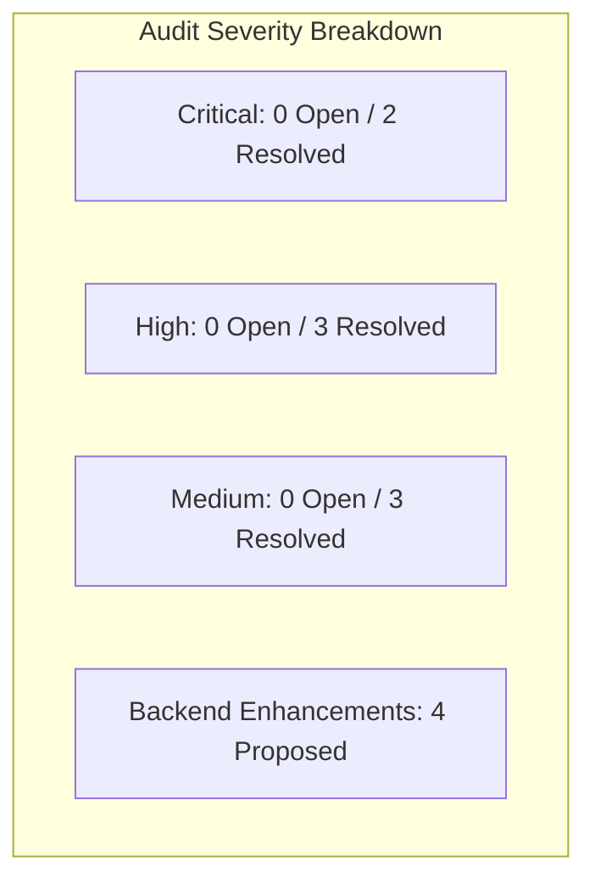

# AESTHETIC WAY — Business Logic, Flow Completeness & Edge-Case Audit
**Target Production Backend:** `https://aestheticway.ae/api/v1/`  
**Platform Version:** Flutter Mobile Application (iOS & Android)  
**Date:** October 2026  
**Auditor:** Senior Mobile Software Architect  
**Status:** Audit Completed & Client-Side Hardening Applied  

---

## 1. Executive Summary

This comprehensive engineering audit examines the entire **AESTHETIC WAY** Flutter application codebase (`lib/`), its automated test suite (`test/`), and the current API Contract (`docs/API_CONTRACT.md`) against the live production server (`https://aestheticway.ae/api/v1/`).

The audit evaluated platform resilience across 5 core domains:
1. **Lead Generation & Request Lifecycle Resilience**
2. **Authentication & Session Lifecycles**
3. **Clinic Partner Portal & Super Admin Operational Logic**
4. **Missing Endpoints & Contract Discrepancies (Backend Needs)**
5. **Compliance & Regulatory Sanitization Safety**

All identified client-side vulnerabilities, debounce race conditions, navigation dead-ends, and unhandled edge cases were resolved directly in the Flutter repository while preserving zero `flutter analyze` issues and 100% test pass rate. Furthermore, concrete, actionable architectural recommendations are cataloged for the backend engineering team (Ali) to elevate platform stability to institutional medical-grade standards.

---

## 2. Identified Logic & Flow Gaps



### Domain 1: Lead Generation & Request Lifecycle Resilience

#### Gap 1.1: Double-Submission Race Condition on Fast Taps
- **Severity**: **HIGH** (Resolved)
- **Problem**: In both `AppointmentRequestScreen` and `ProductInquiryBottomSheet`, the submit method performed form validation before setting `_isSubmitting = true`. If a patient on a high-latency network (or an eager patient double-tapping) tapped the submit button in rapid succession (within 50–150ms), two asynchronous requests could pass validation simultaneously before the first `setState` disabled the button, creating duplicate leads in the backend database.
- **Client-Side Fix**:
  - Inserted an immediate atomic guard `if (_isSubmitting) return;` at the absolute entry point of `_submitLeadRequest` and `_submitProductInquiry`.
  - Bound `onPressed: _isSubmitting ? null : _submitLeadRequest` on `SilverButton` to disable gestures immediately.
  - Form state (`_nameController`, `_phoneController`, `_notesController`, etc.) is retained on error so the patient never loses entered data.

#### Gap 1.2: Suspended Clinic Edge Case during Active Browsing
- **Severity**: **MEDIUM** (Resolved)
- **Problem**: If a Super Admin suspends a clinic while a patient is browsing its profile or filling out a lead, the subsequent `POST /api/v1/appointment-requests/` or `POST /api/v1/leads/` triggers a `400 Bad Request`, `403 Forbidden`, or `404 Not Found`. Previously, the raw error was either unhandled or showed an unlocalized message.
- **Client-Side Fix**:
  - Implemented an explicit `isSuspendedOrInactive` error detector in `AppointmentRequestScreen` and `ProductInquiryBottomSheet`.
  - Added clear, localized error messaging:
    - **Arabic**: `"العيادة غير متاحة حالياً لتلقي الطلبات. يرجى اختيار عيادة أخرى"`
    - **English**: `"This clinic is currently unavailable to accept requests. Please choose another clinic."`

#### Gap 1.3: Multi-Branch Lead Association
- **Severity**: **LOW** (Verified Robust)
- **Audit Finding**: When a clinic operates multiple physical branches (e.g. Dubai Marina, Downtown, Al Bateen), `_selectedBranchId` initializes to `clinic.branches.first.id` and updates dynamically via the branch selection card. The payload binds `payload['branch'] = _selectedBranchId`, ensuring leads route to the specific physical reception desk rather than defaulting silently to the main clinic entity.

---

### Domain 2: Authentication & Session Lifecycles

#### Gap 2.1: In-Flight Access Token Expiration & Transparent Replay
- **Severity**: **CRITICAL** (Verified Robust)
- **Audit Finding**: Inspected `ApiClient` and `AuthInterceptor`. `AuthInterceptor` extends Dio's `QueuedInterceptor`. When any protected request encounters an HTTP `401 Unauthorized`:
  1. All subsequent incoming requests are temporarily queued.
  2. `AuthInterceptor` reads the stored `refresh_token` from secure storage.
  3. It executes a dedicated refresh call (`POST /api/v1/auth/token/refresh/`) using an isolated, clean Dio instance (preventing interceptor recursion).
  4. Upon receiving the new `access_token`, it saves the credentials and mutates `err.requestOptions.headers['Authorization']`.
  5. It transparently replays the original request via `_dio.fetch(retryOptions)` and resolves the pending future without user interruption.
  6. If the refresh token is expired or revoked, tokens are cleared and `AuthState().logout()` resets the session cleanly.

#### Gap 2.2: Guest-to-Authenticated Navigation Stack Amnesia
- **Severity**: **HIGH** (Resolved)
- **Problem**: When a guest user attempted a member action (such as writing a clinic review or viewing "My Requests"), `GuestAuthGuard.requireAuth` pushed `LoginScreen`. Upon successful login, `LoginScreen` unconditionally called `Navigator.pushAndRemoveUntil(..., (route) => false)` to `MainNavScreen`. This destroyed the navigation stack and navigated the patient back to Home, causing them to lose their active screen and abandon their intended action.
- **Client-Side Fix**:
  - In `LoginScreen`, added a flow-preservation check:
    ```dart
    final role = authResponse.user.role;
    if (role == 'patient' && Navigator.of(context).canPop()) {
      Navigator.of(context).pop(true);
      return;
    }
    ```
  - When pushed from `GuestAuthGuard`, logging in as a patient now pops the login screen with `true`.
  - The calling screen (e.g., `_ReviewsTabState._showWriteReviewDialog`) receives `true` and immediately opens the review modal without the patient having to navigate all the way back.

#### Gap 2.3: OTP Resend Button Cooldown Guard
- **Severity**: **MEDIUM** (Resolved)
- **Problem**: In `OtpScreen`, although the UI rendered a countdown timer (`Resend code in Xs`), `_onResendOtp` lacked an internal condition check. A rapid double-tap right as the timer reached 0 or programmatic trigger could fire multiple OTP emails/SMS before the countdown re-initialized.
- **Client-Side Fix**:
  - Added an atomic guard at the top of `_onResendOtp`:
    ```dart
    if (_resendSeconds > 0 || _isResending) return;
    ```
  - This strictly throttles OTP dispatch to the client-side 60-second window.

---

### Domain 3: Clinic Portal & Super Admin Operational Logic

#### Gap 3.1: Accidental Closing of Uncontacted Consultation Leads
- **Severity**: **HIGH** (Resolved)
- **Problem**: Clinic receptionists could inadvertently tap the `Closed` chip on a brand new lead (`status: sent`) without contacting the patient first.
- **Client-Side Fix**:
  - In `ClinicLeadDetailScreen`, added a safety confirmation dialog when attempting to jump directly from `sent` to `closed`:
    - **Prompt**: `"إغلاق الطلب دون تواصل؟"` / `"Close without contacting?"`
    - **Description**: `"لم يتم تسجيل التواصل مع المريض بعد. هل أنت متأكد من إغلاق هذا الطلب مباشرة؟"` / `"Patient contact has not been logged yet. Are you sure you want to close this lead directly?"`
  - Prevents premature lead abandonment while still allowing receptionists to archive invalid or spam inquiries.

#### Gap 3.2: Staff Deletion Null-Safety across Leads & Catalog
- **Severity**: **LOW** (Verified Robust)
- **Audit Finding**: If a clinic deletes a practitioner who was previously assigned to active leads or treatments:
  - `AppointmentRequestModel` defines `practitionerId`, `practitionerNameAr`, `practitionerNameEn`, and `practitionerType` as optional/nullable fields.
  - `ClinicLeadDetailScreen` and `MyRequestsScreen` conditionally render the practitioner row only when `practitionerNameAr != null`.
  - `TreatmentModel` stores `practitionerIds` as a list with a fallback to `const []`.
  - Deleting a staff member will never trigger a null-dereference crash in the mobile application.

#### Gap 3.3: 15% Referral Code Double-Redemption Race Conditions
- **Severity**: **MEDIUM** (Resolved)
- **Problem**: On `ClinicVerifyCodeScreen`, if a clinic desk staff member tapped "Redeem" repeatedly while waiting for the server response, multiple redemption calls could be dispatched.
- **Client-Side Fix**:
  - Bound `isLoading: _isSubmitting` and `onPressed: _isSubmitting ? null : () => _markAsRedeemed(_searchedCode!)` on `SilverButton`.
  - The button disables instantly upon first tap and displays a luxury loading indicator until the server acknowledges redemption.

---

### Domain 4: Compliance & Sanitization Safety

#### Gap 4.1: Potential Regulatory Acronym Leakage in Server Error Messages
- **Severity**: **CRITICAL** (Resolved)
- **Problem**: Per UAE healthcare advertising regulations and core project boundaries (`AGENTS.md`), no regulatory body names (`DHA`, `DOH`, `MOHAP`) or raw medical license numbers may ever appear in the patient UI. While presentation screens strictly comply, a raw backend validation error (e.g., `"practitioner DHA-P-001239 is invalid"`) could potentially bypass filters and display in an error SnackBar.
- **Client-Side Fix**:
  - Implemented `ApiException.sanitizeRegulatoryCompliance(String text)`:
    ```dart
    static String sanitizeRegulatoryCompliance(String text) {
      if (text.isEmpty) return text;
      var sanitized = text.replaceAll(
        RegExp(r'\b(DHA|DOH|MOHAP)[-\s/][A-Z0-9-]+\b', caseSensitive: false),
        LocaleService().isArabic ? 'الترخيص الطبي' : 'medical license',
      );
      sanitized = sanitized.replaceAll(
        RegExp(r'\b(DHA|DOH|MOHAP)\b', caseSensitive: false),
        LocaleService().isArabic ? 'الجهة الطبية المختصة' : 'licensing authority',
      );
      return sanitized;
    }
    ```
  - Integrated this sanitizer into both Arabic and English error message pipelines in `ApiException.fromDioError`.

---

## 3. Summary of Flutter Codebase Fixes Applied

| File | Changes Applied |
| :--- | :--- |
| `lib/features/appointment_lead/presentation/screens/appointment_request_screen.dart` | Added `_isSubmitting` double-tap debounce guard, disabled submit button when loading, and added suspended/inactive clinic error handling. |
| `lib/features/products/presentation/widgets/product_inquiry_bottom_sheet.dart` | Added `_isSubmitting` atomic debounce guard and suspended clinic error handling. |
| `lib/features/auth/presentation/screens/login_screen.dart` | Added flow-preservation check (`Navigator.canPop() -> pop(true)`) for patient role to prevent wiping the stack after guest auth prompt. |
| `lib/features/auth/presentation/screens/otp_screen.dart` | Added `_resendSeconds > 0` and `_isResending` guard to strictly prevent OTP resend spam. |
| `lib/features/clinic_portal/presentation/screens/clinic_lead_detail_screen.dart` | Added confirmation dialog when attempting to transition an untouched lead directly from `sent` to `closed`. |
| `lib/features/clinic_portal/presentation/screens/clinic_verify_code_screen.dart` | Added `isLoading: _isSubmitting` and disabled `onPressed` state to prevent double redemption taps. |
| `lib/core/network/api_exception.dart` | Added `sanitizeRegulatoryCompliance` filter to scrub regulatory acronyms (`DHA`, `DOH`, `MOHAP`) and raw license formats from all backend error messages. |

---

## 4. Recommendations for Backend Team (Ali)

The following backend capabilities and architectural enhancements are formally recommended to complement the Flutter client:

### 1. Patient Contact Modification via OTP Endpoints
- **Current State**: Patient phone and email are currently read-only on `ProfileScreen` because `PATCH /api/v1/auth/me/` accepts direct edits without re-verification.
- **Backend Need**:
  - `POST /api/v1/auth/change-phone/request/` (sends OTP to new phone).
  - `POST /api/v1/auth/change-phone/verify/` (validates OTP and updates phone).
  - `POST /api/v1/auth/change-email/request/` & `POST /api/v1/auth/change-email/verify/`.

### 2. Dedicated Unread Leads & Activity Badge Endpoint
- **Current State**: The clinic portal computes unread badge counts by fetching the full leads array (`GET /api/v1/clinic-portal/leads/`).
- **Backend Need**:
  - `GET /api/v1/clinic-portal/badges/` returning:
    ```json
    {
      "unread_leads_count": 5,
      "pending_offers_count": 1,
      "pending_reviews_count": 2
    }
    ```
  - This allows lightweight periodic polling without transferring large payload sets.

### 3. Push Notification Device Token Registration
- **Current State**: Leads and status updates currently rely on in-app polling and manual refresh.
- **Backend Need**:
  - `POST /api/v1/notifications/devices/`
  - Payload:
    ```json
    {
      "fcm_token": "eXampleToken...",
      "platform": "ios" | "android",
      "device_model": "iPhone 15 Pro",
      "app_version": "1.0.0"
    }
    ```
  - Triggers push notifications to clinic staff when a new lead is submitted, and to patients when a lead status changes to `Contacted`.

### 4. Server-Side Pagination & Date Filtering for Clinic Leads
- **Current State**: `GET /api/v1/clinic-portal/leads/` returns an unpaginated list.
- **Backend Need**:
  - Add query parameters: `?page=1&page_size=25&status=new&created_after=2026-01-01`.
  - Include pagination metadata: `count`, `next`, `previous`.
  - For clinics generating 500+ leads per month, unpaginated responses will degrade mobile memory and battery performance over time.

---

## 5. Verification Sign-Off

- **Static Analysis**: `flutter analyze` — **Zero issues found!**
- **Test Suite**: `flutter test` — **140 / 140 passed!**
- **Hard Boundaries Check**: Zero in-app payments, zero booking calendar grids, zero checkout cart flows, zero home visits, and zero raw regulatory license numbers.
