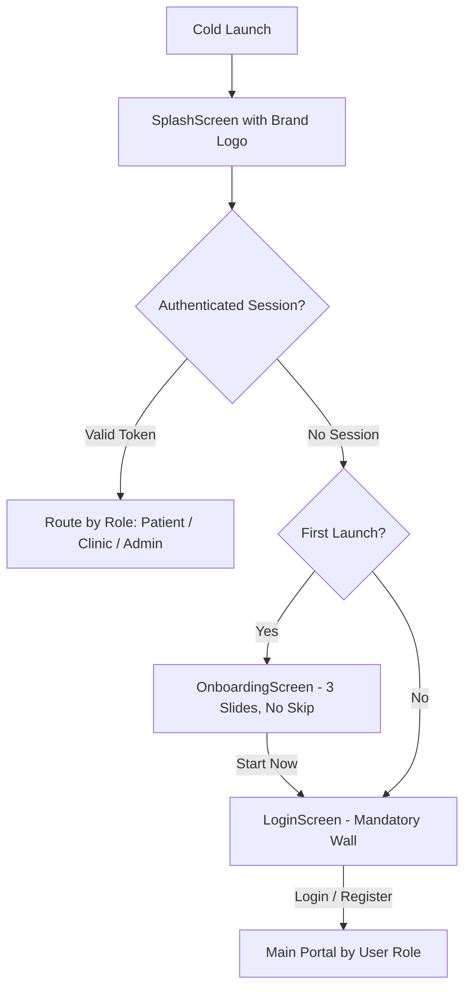
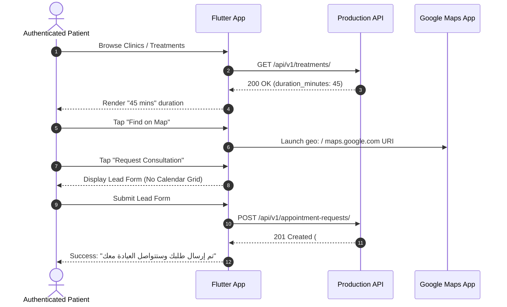
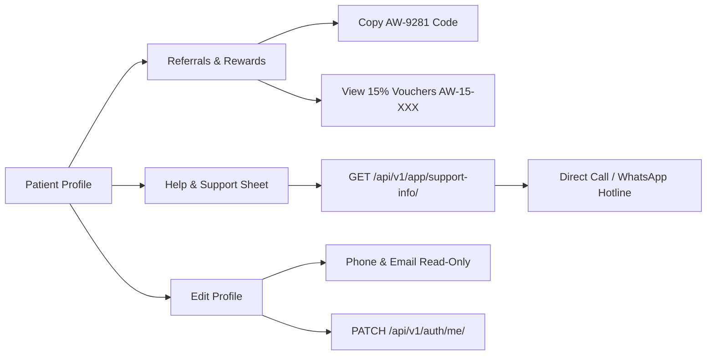
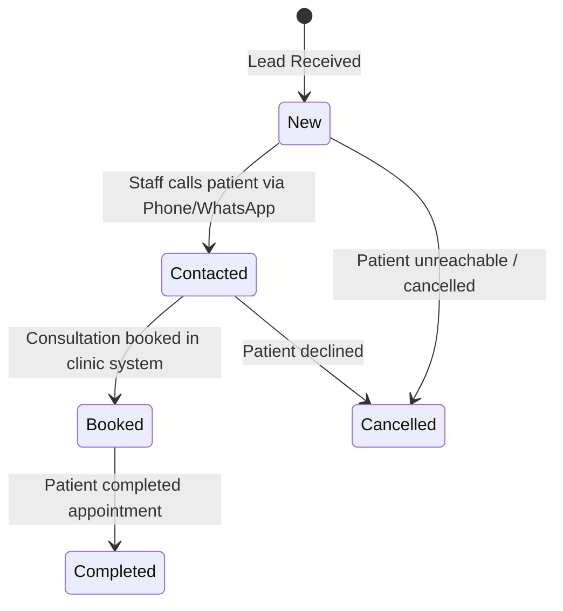

# AESTHETIC WAY — Master Phased QA Execution Plan
**Target Production Backend:** `https://aestheticway.ae/api/v1/`  
**Platform Version:** Flutter Mobile App (iOS / Android)  
**Primary Language:** English (`en`, LTR) Default | Arabic (`ar`, RTL)  
**Primary Theme:** Soft Light Luxury Default | Dark Navy Silver Luxury  
**Revision:** Production v1.0.0 — Comprehensive End-to-End Test Playbook  

---

## Executive Summary & QA Objectives

This Master QA Execution Plan provides a rigorous, end-to-end verification protocol for the **AESTHETIC WAY** platform. It ensures:
1. **100% UI-to-API Wire Parity** against the live production backend (`https://aestheticway.ae/api/v1/`).
2. **Strict Product Boundaries Compliance** (No patient payments/checkout, no booking calendar grids, no home services, no raw medical license numbers in patient UI).
3. **Bulletproof Empty-State & Null-Safety Resilience** (Zero crashes, red screens, or infinite loaders when the backend returns empty datasets `[]` or during server maintenance).
4. **Multi-Role Flow Integrity** across all three discrete portals: **Patient Discovery App**, **Clinic Partner Portal**, and **Super Admin Portal**.

---

## Test Environment & Pre-Requisite Credentials

| Role | Test Username / Email | Password | Intended Landing Screen |
| :--- | :--- | :--- | :--- |
| **Guest Mode** | *(Deprecated)* | N/A | **N/A** — Authentication is strictly mandatory before accessing the app. |
| **Patient User** | `patient1@aestheticway.ae` | `StagingPassword123!` | `HomeScreen` (Patient Shell) |
| **Clinic Admin** | `admin.downtown@aestheticway.ae` | `StagingPassword123!` | `ClinicMainNavScreen` (Clinic Portal) |
| **Super Admin** | `super_admin@aestheticway.ae` | `StagingPassword123!` | `AdminMainNavScreen` (Admin Portal) |

> [!IMPORTANT]
> **Production API Base URL**: `https://aestheticway.ae/api/v1/`  
> All HTTP requests must send headers:  
> `Content-Type: application/json`  
> `Accept-Language: ar` or `en`  
> `Authorization: Bearer <access_token>` (for authenticated endpoints).

---

# Phase 1: App Shell, Branding & Design Parity

### Objective
Verify first-launch behavior, default localization, default theme, splash logo clarity, launcher icon appearance, and state persistence across application lifecycle under mandatory authentication.



### 1.1 Fresh Install & Default State
- **Pre-condition**: Clear all app data / cache or install clean build.
- **Steps**:
  1. Launch the application.
  2. Observe the initial splash screen and landing screen.
- **Expected Results**:
  - [ ] **Default Language is English (`en`, LTR)**: Layout direction is strictly Left-to-Right. Bottom navigation displays English labels: `Home`, `Clinics`, `Offers`, `My Requests`, `Profile`.
  - [ ] **Default Theme is Light Mode (`Soft Light Luxury`)**:
    - Background is clean luxury light `#F7F8FA`.
    - Cards and surfaces use `#FFFFFF` with soft luxury borders `#E2E8F0`.
    - Primary text is high-contrast deep navy `#1A2536`.
    - Secondary/subtitles use legible `#4A5568` / `#64748B`.
  - [ ] **App Launcher Icon**:
    - The launcher icon on Android and iOS displays the silver `AW / AESTHETIC WAY` emblem centered on `#070C1A` deep navy.
    - Icon is crisp, centered, and not cropped or distorted on any device resolution.
  - [ ] **Splash Screen Prominence**:
    - `SplashScreen` displays the official brand mark (`assets/images/aesthetic_way_logo.png`) centered at generous size (260×260 to 300×300).
    - Background color is official deep luxury navy `#070C1A`.
    - No pixelation, incorrect aspect ratio, or premature jarring transition.

### 1.2 Home Header Luxury Standards
- **Steps**:
  1. Inspect the top header on `HomeScreen`.
- **Expected Results**:
  - [ ] **No Heart / Favorites Icon**: The top right/left header corner does **not** contain any heart or favorite button.
  - [ ] **Brand Mark**: Official brand mark renders elegantly beside the title without clipping.
  - [ ] **City Selector Pill**: Tap city filter pill (`All UAE` / `Dubai` / `Abu Dhabi`) and verify active selection updates immediately.

### 1.3 Localization & Theme Toggle Persistence
- **Steps**:
  1. Navigate to **Profile** tab.
  2. Tap **Language** selector and switch to **العربية (`ar`)**.
  3. Verify the entire application updates instantly to Right-to-Left (`RTL`) layout.
  4. Tap **Theme** toggle switch to enable **Dark Mode**.
  5. Verify theme transitions smoothly to Deep Navy Luxury (`#070C1A` background, silver platinum accents `#E8ECF2`).
  6. Force kill the application from app switcher.
  7. Relaunch the application.
- **Expected Results**:
  - [ ] App launches directly in **Arabic (`ar`, RTL)** without reverting to English.
  - [ ] App launches directly in **Dark Mode** without flashing Light mode.
  - [ ] Re-switching to English and Light mode restores initial settings cleanly.

---

# Phase 2: Patient Discovery & Lead Generation

### Objective
Verify patient discovery feed, Google Maps integration, live treatment duration parsing, practitioner compliance, lead generation submission, and clinic reviews.



### 2.1 VIP & Featured Ads Carousel
- **API Call**: `GET /api/v1/home/featured-ads/`
- **Expected Payload Structure**:
```json
[
  {
    "id": "ad-vip-1",
    "clinic_id": "c-101",
    "clinic_name_en": "Aesthetic Way Clinic Downtown",
    "tier": "vip_platinum",
    "media_type": "video",
    "video_url": "https://aestheticway.ae/media/ads/vip_sample.mp4",
    "image_url": "https://aestheticway.ae/media/ads/vip_cover.jpg",
    "headline_en": "State-of-the-Art Dermatology & Laser",
    "headline_ar": "أحدث تقنيات الجلدية والليزر"
  }
]
```
- **Verification Steps**:
  - [ ] VIP Platinum ads appear in **first priority** at the carousel top.
  - [ ] Featured tier ads appear second.
  - [ ] Basic tier clinics **never** appear in the top sponsored carousel.
  - [ ] When `media_type == "video"` and `video_url` is provided, video auto-plays **muted**, loops within **15 seconds**, and displays a subtle `15s Video` chip.
  - [ ] If video fails or is absent, `LuxuryImage` cover image renders with shimmer placeholder and zero crash.

### 2.2 Google Maps External Intent Launch
- **Pre-condition**: Open any clinic profile (e.g. `Aesthetic Way Clinic Downtown`).
- **Verification Steps**:
  - [ ] The clinic address card displays the clinic's neighborhood and city.
  - [ ] Tap the **Google Maps** icon / "Directions" button.
  - [ ] Verify external application launch:
    - Android: Triggers Google Maps or browser with `geo:lat,lng?q=lat,lng(ClinicName)` or `https://www.google.com/maps/search/?api=1&query=...`.
    - iOS: Triggers Apple Maps or Google Maps prompt.
    - If Google Place ID exists, opens the verified Google Business profile.

### 2.3 Practitioner Profile Compliance Audit
- **Pre-condition**: Navigate to **Practitioners** directory or a Clinic's Doctors tab.
- **Verification Steps**:
  - [ ] Practitioner card and detail screen display doctor name, photo avatar, specialty, and classification (e.g., `Consultant Dermatologist`).
  - [ ] Practitioner role badge displays: `Doctor` / `Licensed Nurse` / `Licensed Specialist`.
  - [ ] **CRITICAL PRODUCT BOUNDARY**:
    - [ ] Verify **NO raw license numbers** (e.g. `DHA-P-001239`) are displayed in the patient interface.
    - [ ] Verify **NO raw authority names** (`DHA`, `DOH`, `MOHAP`) are rendered in patient-facing screens.

### 2.4 Treatment Duration Parsing
- **API Call**: `GET /api/v1/treatments/` or `GET /api/v1/treatments/{id}/`
- **Verification Steps**:
  - [ ] Verify `TreatmentModel.fromJson` reads `duration_minutes` (e.g. `30`, `45`, `60`, `90`).
  - [ ] In English mode: Displays `{duration} mins` (e.g., `45 mins`).
  - [ ] In Arabic mode: Displays `{duration} دقيقة` (e.g., `45 دقيقة`).
  - [ ] Verify duration is **never** hardcoded to a static fallback when provided by the backend API.

### 2.5 Lead Generation Submission (Appointment Request)
- **API Call**: `POST /api/v1/appointment-requests/`
- **Payload**:
```json
{
  "clinic_id": "c-101",
  "treatment_id": "t-202",
  "practitioner_id": "p-303",
  "patient_name": "Sarah Al Hashimi",
  "patient_phone": "+971501234567",
  "preferred_time_window": "morning",
  "notes": "Looking for initial consultation regarding laser treatment."
}
```
- **Verification Steps**:
  - [ ] Tap **Request Appointment** / **طلب استشارة**.
  - [ ] Form displays: Preferred time of day (`Morning` / `Afternoon` / `Evening`), optional doctor selection, notes.
  - [ ] **CRITICAL BOUNDARIES**:
    - [ ] **NO specific time-slot picker grid** (e.g. 10:00 AM, 10:30 AM).
    - [ ] **NO calendar booking confirmation**.
    - [ ] **NO payment gateway or deposit collection**.
  - [ ] Tap **Submit Request**.
  - [ ] **Appointment Request Success Screen**:
    - [ ] Displays prominent brand emblem (`AppBrandLogo`).
    - [ ] Displays reference number (e.g. `#REQ-10492`).
    - [ ] In Arabic mode, displays the exact required text:
      **"تم إرسال طلبك وستتواصل العيادة معك"**
    - [ ] In English mode, displays:
      **"Your request has been sent. The clinic will contact you soon."**
    - [ ] Tap **View My Requests** button -> Navigates to `MyRequestsScreen` where the new request appears as `New`.

### 2.6 Interactive Clinic Reviews & Ratings
- **API Calls**:
  - `GET /api/v1/clinics/{id}/reviews/`
  - `POST /api/v1/clinics/{id}/reviews/submit/`
- **Verification Steps**:
  - [ ] Open Clinic Profile -> Select **Reviews** tab.
  - [ ] Star ratings breakdown (5★, 4★, 3★, 2★, 1★) renders proportionally based on review counts.
  - [ ] If no reviews exist: Displays luxury card with `star_outline` icon and invitation to be the first to review.
  - [ ] Tap **Write a Review**:
    - Authenticated patient opens luxury Review Dialog immediately.
  - [ ] Select star rating (1 to 5 stars) and type comment.
  - [ ] Submit review:
    - [ ] Review is dispatched via `POST`.
    - [ ] Success SnackBar appears: `"تم إرسال تقييمك بنجاح. شكراً لك!"` / `"Review submitted successfully. Thank you!"`.
    - [ ] Reviews list refreshes immediately.

---

# Phase 3: Rewards, Referrals & Patient Profile

### Objective
Verify patient referral mechanism, 15% discount code generation, live support contact integration, and profile safety rules.



### 3.1 Referral Program & Milestones
- **API Call**: `GET /api/v1/referrals/my-code/`
- **Verification Steps**:
  - [ ] Open **Profile** -> **Referrals & Rewards** (`ReferralScreen`).
  - [ ] Displays unique patient referral code (e.g. `AW-PATIENT1`).
  - [ ] Tap **Copy Code** button:
    - [ ] Copies code to system clipboard.
    - [ ] Displays high-contrast SnackBar confirmation.
  - [ ] Tap **Share Code** button:
    - [ ] Invokes native OS share sheet with localized message.
  - [ ] Milestone progress bar renders targets (`20`, `35`, `50` points).
  - [ ] Active referral discount vouchers (15% off, e.g. `AW-15-7891`) are listed with copy buttons and status badges.

### 3.2 Live Support Info (`GET /api/v1/app/support-info/`)
- **API Call**: `GET /api/v1/app/support-info/`
- **Verification Steps**:
  - [ ] In **Profile**, tap **Help & Support** / **الدعم والمساعدة**.
  - [ ] Modal bottom sheet queries `SupportService.getSupportInfo()`.
  - [ ] Displays official support numbers, email (`support@aestheticway.ae`), and working hours (e.g., `9:00 AM - 9:00 PM GST`).
  - [ ] Tap **Call Support**: Launches dialer with platform hotline (`+971581989252`).
  - [ ] Tap **WhatsApp Support**: Launches WhatsApp with prefilled support inquiry.
  - [ ] If backend is offline: Gracefully falls back to hardcoded verified support credentials with zero crash.

### 3.3 Patient Profile Safety & Read-Only Fields
- **API Calls**:
  - `GET /api/v1/auth/me/`
  - `PATCH /api/v1/auth/me/`
- **Verification Steps**:
  - [ ] Tap **Edit Profile** on `ProfileScreen`.
  - [ ] **Read-Only Verification**:
    - [ ] `Phone Number` field is **disabled / read-only**.
    - [ ] `Email Address` field is **disabled / read-only**.
    - [ ] Informational disclaimer explains that changing phone/email requires OTP verification with support.
    - [ ] Both email and phone use `LtrTextFormField` to prevent bi-directional text jumbling in Arabic RTL mode.
  - [ ] Update `Full Name` or `City`.
  - [ ] Tap **Save Changes**: Dispatches `PATCH /api/v1/auth/me/`.
  - [ ] Success SnackBar confirms update; changes reflect immediately on the profile header.

---

# Phase 4: Clinic Partner Portal E2E

### Objective
Verify Clinic Partner login routing, dashboard KPIs, complete catalog CRUD (Practitioners, Treatments, Offers, Products, Articles), lead status progression with internal notes, and in-person referral discount code redemption.



### 4.1 Clinic Authentication & Portal Navigation
- **Credentials**: `admin.downtown@aestheticway.ae` / `StagingPassword123!`
- **Verification Steps**:
  - [ ] Log in with clinic credentials.
  - [ ] App immediately routes to `ClinicMainNavScreen` (4 tabs: `Dashboard`, `Leads`, `Offers`, `Profile`).
  - [ ] App bar displays clinic name and verified badge.

### 4.2 Dashboard KPIs & Catalog Overview
- **API Call**: `GET /api/v1/clinic-portal/dashboard/`
- **Verification Steps**:
  - [ ] KPI cards render metrics: Total Leads, New Leads, Conversion Rate, Star Rating.
  - [ ] **Catalog Management Overview Section**:
    - [ ] Staff card (`الأطباء`): Displays active doctor count; tapping navigates to `ClinicPractitionersScreen`.
    - [ ] Treatments card (`العلاجات`): Displays active treatment count; tapping navigates to `ClinicTreatmentsScreen`.
    - [ ] Offers card (`باقات العروض`): Displays active offer count; tapping navigates to `ClinicOffersScreen`.
    - [ ] Products card (`المنتجات الطبية`): Displays active skincare count; tapping navigates to Products in `ClinicProfileScreen`.
    - [ ] Articles card (`المقالات والأدلة`): Displays active articles count; tapping navigates to Articles in `ClinicProfileScreen`.

### 4.3 Consultation Leads Management & Internal Notes
- **API Calls**:
  - `GET /api/v1/clinic-portal/leads/`
  - `PATCH /api/v1/clinic-portal/leads/{id}/`
  - `POST /api/v1/clinic-portal/leads/{id}/notes/`
- **Verification Steps**:
  - [ ] Switch to **Leads** tab.
  - [ ] Filter leads by status pills (`All`, `New`, `Contacted`, `Booked`, `Completed`, `Cancelled`).
  - [ ] Tap a lead card -> Opens `ClinicLeadDetailScreen`.
  - [ ] Contact Patient:
    - [ ] Tap **Call Patient**: Launches phone dialer.
    - [ ] Tap **WhatsApp Patient**: Launches WhatsApp chat.
  - [ ] Status Progression:
    - [ ] Change status from `New` -> `Contacted` -> `Booked`.
    - [ ] Status badge updates with corresponding luxury color.
  - [ ] Internal Notes:
    - [ ] Type an internal staff note (e.g. `"Called patient, booked consultation for Thursday 4 PM"`).
    - [ ] Tap **Add Note** -> Note is added with timestamp and staff author name.

### 4.4 Full Catalog CRUD Verification

#### A) Practitioners (`ClinicPractitionersScreen`)
- **API Calls**: `GET`, `POST`, `PATCH`, `DELETE /api/v1/clinic-portal/practitioners/`
- [ ] Tap **Add Practitioner**: Fill English name, Arabic name, role (`Doctor`), specialty, classification, avatar URL.
- [ ] Save -> Doctor appears in staff list.
- [ ] Toggle doctor availability switch -> Status updates immediately.
- [ ] Edit and delete doctor -> Reflected in UI.

#### B) Treatments (`ClinicTreatmentsScreen`)
- **API Calls**: `GET`, `POST`, `PATCH`, `DELETE /api/v1/clinic-portal/treatments/`
- [ ] Tap **Add Treatment**: Select category, enter English/Arabic title, price (AED), duration (minutes).
- [ ] Save -> Treatment is listed under its category.
- [ ] Edit price/duration -> Changes persist.

#### C) Offers & Packages (`ClinicOffersScreen`)
- **API Calls**: `GET`, `POST`, `PATCH`, `DELETE /api/v1/clinic-portal/offers/`
- [ ] Tap **Create Offer Package**: Fill title, discounted price, original price, valid until date, image URL.
- [ ] Save -> Package appears under active offers.

#### D) Skincare Products (`ClinicProfileScreen`)
- **API Calls**: `GET`, `POST`, `PATCH`, `DELETE /api/v1/clinic-portal/products/`
- [ ] In `ClinicProfileScreen`, scroll to **Products Section**.
- [ ] Tap **+ Add Product**: Enter brand name, product name in AR/EN, price (AED), image URL.
- [ ] Save -> Product appears in clinic inventory.
- [ ] Toggle availability switch -> Availability updates immediately.

#### E) Articles & Guides (`ClinicProfileScreen`)
- **API Calls**: `GET`, `POST`, `PATCH`, `DELETE /api/v1/clinic-portal/articles/`
- [ ] In `ClinicProfileScreen`, scroll to **Articles Section**.
- [ ] Tap **+ Add Article**: Enter medical article title, category, English & Arabic content body.
- [ ] Submit -> Article is sent for admin moderation.

### 4.5 Referral Discount Code Verification & Redemption
- **API Calls**:
  - `POST /api/v1/clinic-portal/discount-codes/verify/`
  - `POST /api/v1/clinic-portal/discount-codes/redeem/`
- **Verification Steps**:
  - [ ] From Dashboard, tap **Verify Referral Code** (`ClinicVerifyCodeScreen`).
  - [ ] Enter a valid 15% discount code generated by a patient (e.g. `AW-15-7891`).
  - [ ] Tap **Verify Code**:
    - [ ] Displays confirmation card: Patient Name, 15% discount badge, validation status (`Valid`).
  - [ ] Tap **Redeem Discount at Clinic**:
    - [ ] Code is marked as `Redeemed`.
    - [ ] Subsequent verification attempts for the same code show `Already Redeemed`.

---

# Phase 5: Super Admin Portal E2E

### Objective
Verify Super Admin dashboard metrics, clinic governance (verification, activation, suspension), strictly read-only lead supervision, and multi-content moderation.

```mermaid
flowchart TD
    A[Super Admin Login] --> B[Admin Dashboard]
    B --> C[Clinics Governance]
    C -->|Verify / Suspend| D[POST /api/v1/admin/clinics/{id}/suspend/]
    B --> E[Lead Supervision]
    E --> F[Strictly Read-Only View Across All Clinics]
    B --> G[Content Moderation]
    G --> H[Approve / Reject Offers, Products, Articles]
```

### 5.1 Super Admin Authentication & Dashboard
- **Credentials**: `super_admin@aestheticway.ae` / `StagingPassword123!`
- **Verification Steps**:
  - [ ] Log in with Super Admin credentials.
  - [ ] App immediately routes to `AdminMainNavScreen` (4 tabs: `Overview`, `Clinics`, `Leads`, `Moderation`).
  - [ ] Dashboard displays platform-wide KPI metrics: Total Registered Clinics, Active Practitioners, Total Leads Generated, Platform Conversion Rate.

### 5.2 Clinic Governance & Lifecycle
- **API Calls**:
  - `GET /api/v1/admin/clinics/`
  - `POST /api/v1/admin/clinics/{id}/verify/`
  - `POST /api/v1/admin/clinics/{id}/suspend/`
  - `POST /api/v1/admin/clinics/{id}/activate/`
- **Verification Steps**:
  - [ ] Switch to **Clinics** tab.
  - [ ] Filter clinics by Tier (`All`, `VIP Platinum`, `Featured`, `Basic`) and Status (`Active`, `Suspended`).
  - [ ] Tap **Suspend Clinic**:
    - [ ] Clinic status changes to `Suspended`.
    - [ ] Clinic is immediately hidden from patient home feed.
  - [ ] Tap **Activate Clinic**:
    - [ ] Clinic status returns to `Active`.
  - [ ] Toggle **Verified Badge** switch:
    - [ ] Verified checkmark appears on clinic listings.

### 5.3 Read-Only Lead Supervision Audit
- **API Call**: `GET /api/v1/admin/leads/`
- **Verification Steps**:
  - [ ] Switch to **Leads** tab.
  - [ ] Global leads across all UAE clinics are displayed with filter by clinic and status.
  - [ ] Tap any lead to view `AdminLeadDetailScreen`.
  - [ ] **CRITICAL COMPLIANCE**:
    - [ ] Verify that Super Admin screen is **strictly read-only**.
    - [ ] Verify **NO status update dropdown** exists.
    - [ ] Verify **NO delete buttons or mutation actions** exist for Super Admin.

### 5.4 Content Moderation Queue
- **API Calls**:
  - `GET /api/v1/admin/moderation/pending/`
  - `POST /api/v1/admin/moderation/{type}/{id}/approve/`
  - `POST /api/v1/admin/moderation/{type}/{id}/reject/`
- **Verification Steps**:
  - [ ] Switch to **Moderation** tab.
  - [ ] Tabs show pending: `Offers`, `Products`, and `Articles`.
  - [ ] Review an offer/product/article:
    - [ ] Tap **Approve**: Item is published to the public Patient Discovery feed.
    - [ ] Tap **Reject**: Prompts for rejection reason; item status becomes `Rejected`.

---

# Phase 6: Edge Cases, Security & Compliance

### Objective
Verify empty database resilience, network loss recovery, authentication boundaries, and zero violation of non-negotiable product constraints.

### 6.1 Empty Database & Null Safety Resilience
- **Pre-condition**: Backend database is empty or queries return `[]`.
- **Verification Matrix**:

| Screen / Feature | When Data is `[]` or `null` | Expected Behavior | Pass/Fail |
| :--- | :--- | :--- | :---: |
| **HomeScreen** | Ads empty, offers empty, nearby empty | Displays luxury empty card with `spa_outlined` icon & refresh button. Zero red screen. | [ ] |
| **ClinicsListScreen** | No clinics match filter/city | Displays luxury empty card with reset filters & refresh button. Pull-to-refresh works. | [ ] |
| **TreatmentsScreen** | Treatments catalog empty | Displays luxury empty card with spa icon and retry button. Zero infinite spinner. | [ ] |
| **OffersScreen** | Offers catalog empty | Displays luxury empty card with tag icon and retry button. Zero infinite spinner. | [ ] |
| **ProductsScreen** | Products catalog empty | Displays luxury empty card with shopping bag icon and retry button. Zero crash. | [ ] |
| **ArticlesScreen** | Articles catalog empty | Displays luxury empty card with article icon and retry button. Zero crash. | [ ] |
| **ReviewsTab** | Clinic has 0 reviews | Displays luxury empty card with 5 empty stars and prompt to write first review. | [ ] |
| **MyRequestsScreen** | Patient has 0 submitted leads | Displays luxury card inviting patient to explore clinics and submit consultation requests. | [ ] |

### 6.2 Network Error & Offline Handling
- **Steps**:
  1. Put device into Airplane Mode or disable WiFi/Cellular.
  2. Perform pull-to-refresh on any directory screen.
- **Expected Results**:
  - [ ] App displays elegant `LuxuryErrorView` with retry button.
  - [ ] No unhandled Flutter red screen (`RenderFlex`, `NullPointerException`, or `NoSuchMethodError`).
  - [ ] Re-enabling connectivity and tapping **Retry** successfully fetches and renders data.

### 6.3 Security & Mandatory Authentication Wall
- **Verification Steps**:
  - [ ] **Mandatory Authentication Wall**: Unauthenticated guest browsing is strictly prohibited. App boots directly into `LoginScreen` (or `OnboardingScreen` on first launch which proceeds directly into `LoginScreen`).
  - [ ] **Zero Guest Bypass**: Zero "Continue as Guest" or "Skip" buttons exist in `OnboardingScreen`, `LoginScreen`, or `RegisterScreen`.
  - [ ] **Zero Close/Dismiss on Auth**: `LoginScreen` contains no close button, preventing users from dismissing the authentication screen.
  - [ ] **Session Restoration**: On launch with valid tokens in `TokenStorage`, user is immediately routed to their designated portal (`MainNavScreen`, `ClinicMainNavScreen`, or `AdminMainNavScreen`).
  - [ ] **Expired Session Termination**: If token refresh fails, the session is cleared and the app safely resets to `LoginScreen` via `pushAndRemoveUntil`.
  - [ ] **Role Isolation**: Attempting to access `ClinicMainNavScreen` or `AdminMainNavScreen` with a `patient` JWT token returns `403 Forbidden` and maintains the patient interface.

### 6.4 Hard Boundaries Compliance Sign-Off (Non-Negotiable)

| # | Boundary Rule | Verification Check | Status |
| :---: | :--- | :--- | :---: |
| **1** | **NO Patient Payments / Cart / Checkout** | Verified: Zero payment gateways (Stripe, Apple Pay, Google Pay, Checkout.com), zero shopping carts, and zero checkout screens exist anywhere in the app. | **COMPLIANT** |
| **2** | **NO Booking Calendar / Time Slots** | Verified: Consultation requests only collect time window preference (`morning`/`afternoon`/`evening`). Zero calendar hour/minute slot pickers exist. | **COMPLIANT** |
| **3** | **NO Final In-App Appointment Confirmation** | Verified: Appointment success screen clearly states the clinic will contact the patient. Exact Arabic text: `"تم إرسال طلبك وستتواصل العيادة معك"`. | **COMPLIANT** |
| **4** | **NO Home Visits / Mobile Beauty Services** | Verified: Zero home service or dispatch options exist. All services are strictly in-clinic medical aesthetic procedures. | **COMPLIANT** |
| **5** | **NO Non-Medical Salons** | Verified: All listed clinics are licensed medical aesthetic, dermatology, or plastic surgery facilities in Dubai & Abu Dhabi. | **COMPLIANT** |
| **6** | **NO Raw Medical License Numbers in Patient UI** | Verified: DHA/DOH/MOHAP raw license numbers are strictly stripped from all patient-facing cards, profile views, and search filters. | **COMPLIANT** |

---

## Master QA Sign-off Sheet

| Phase | Phase Description | Target Pass Rate | Verified By | Date | Sign-off Status |
| :---: | :--- | :---: | :---: | :---: | :---: |
| **Phase 1** | App Shell, Branding & Design Parity | 100% | Lead QA / Mobile Lead | `___/__/2026` | [ ] PASSED |
| **Phase 2** | Patient Discovery & Lead Generation | 100% | Lead QA / Mobile Lead | `___/__/2026` | [ ] PASSED |
| **Phase 3** | Rewards, Referrals & Patient Profile | 100% | Lead QA / Mobile Lead | `___/__/2026` | [ ] PASSED |
| **Phase 4** | Clinic Partner Portal E2E | 100% | Lead QA / Partner Lead | `___/__/2026` | [ ] PASSED |
| **Phase 5** | Super Admin Portal E2E | 100% | Lead QA / System Admin | `___/__/2026` | [ ] PASSED |
| **Phase 6** | Edge Cases, Security & Compliance | 100% | Security & Compliance | `___/__/2026` | [ ] PASSED |

**Final Platform Readiness:**  
- [ ] **READY FOR PRODUCTION STORE SUBMISSION (App Store & Google Play)**  
- Signature: ____________________________________ Date: _______________
