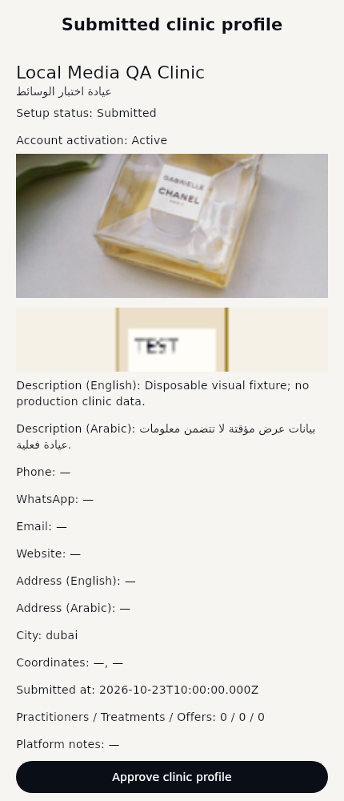
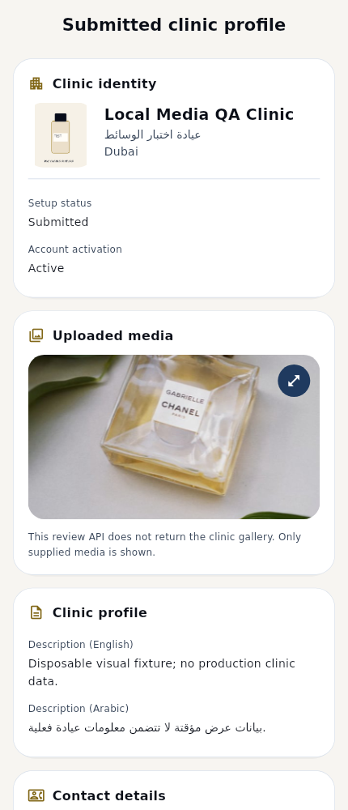
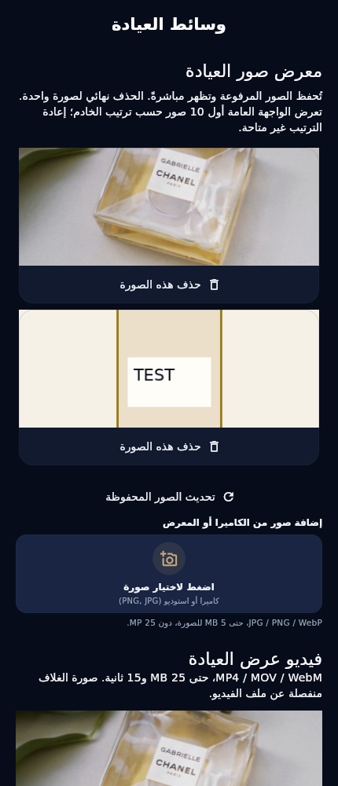
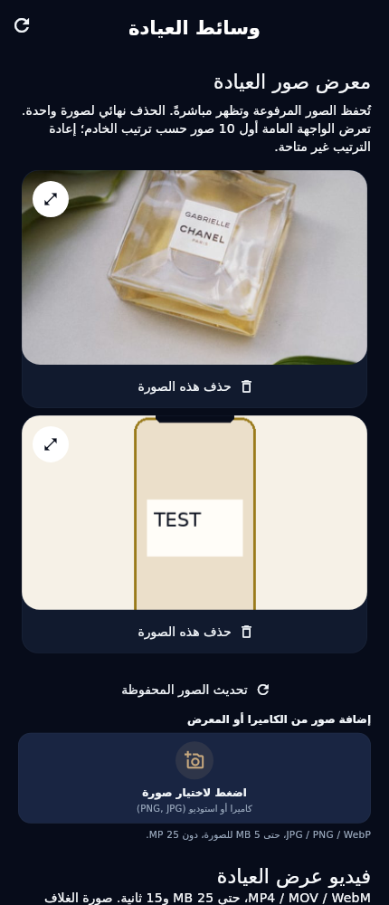
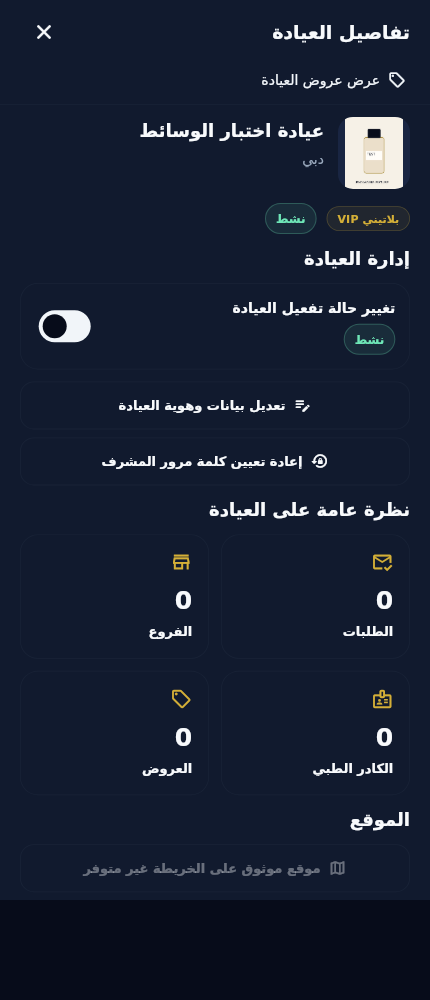
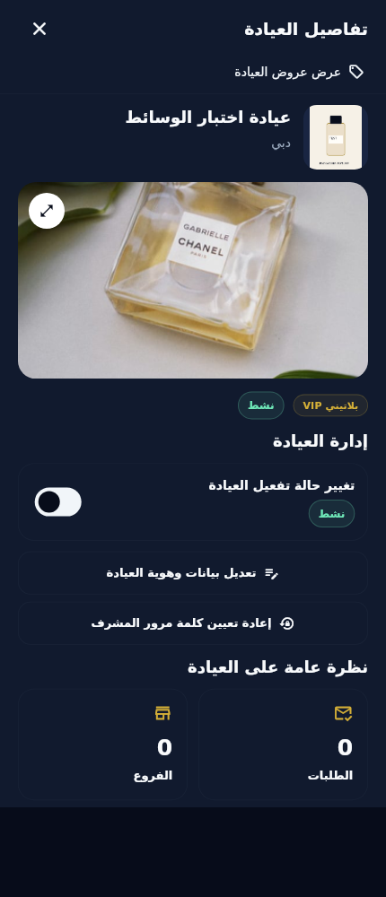
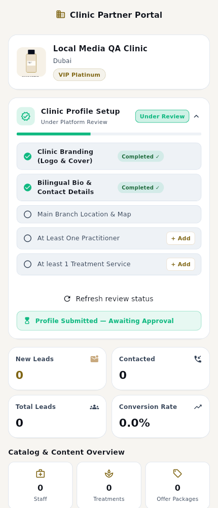
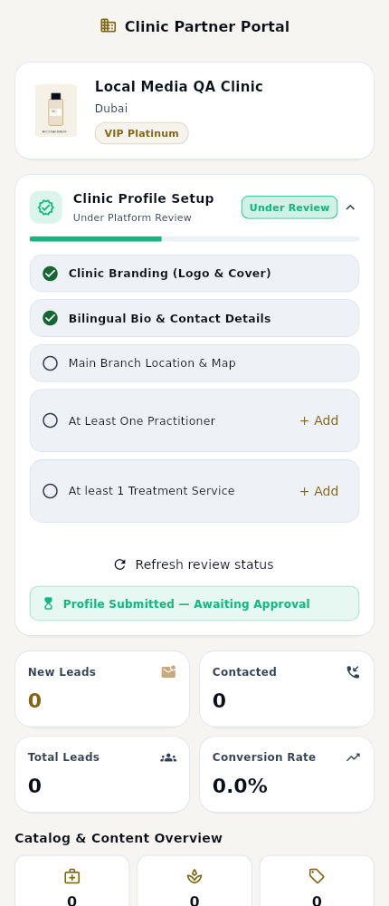

# Actual Flutter before/after comparisons

Baseline: `86c82bdd7900728bb336b4d8cb6bbd845e5fdd23`, rendered in a detached worktree with the same test. After: this PR update. Both use Flutter 3.41.5, bundled visual-test fonts, DPR 1, 430×1000. These are **sanitized fixture renders**, not live clinics, real entitlement evidence or physical-device verification. No generated/production photographs were substituted. Patient goldens are unchanged.

## Representative comparisons

| Surface | Before | After |
|---|---|---|
| review · light · en |  |  |
| media · dark · ar |  |  |
| details · dark · ar |  |  |
| dashboard · light · en |  |  |

## Complete comparison index

| Surface | Theme | Language | Before | After |
|---|---|---|---|---|
| review | light | en | [PNG](before/polish_review_light_en.png) | [PNG](after/polish_review_light_en.png) |
| review | light | ar | [PNG](before/polish_review_light_ar.png) | [PNG](after/polish_review_light_ar.png) |
| review | dark | en | [PNG](before/polish_review_dark_en.png) | [PNG](after/polish_review_dark_en.png) |
| review | dark | ar | [PNG](before/polish_review_dark_ar.png) | [PNG](after/polish_review_dark_ar.png) |
| details | light | en | [PNG](before/polish_details_light_en.png) | [PNG](after/polish_details_light_en.png) |
| details | light | ar | [PNG](before/polish_details_light_ar.png) | [PNG](after/polish_details_light_ar.png) |
| details | dark | en | [PNG](before/polish_details_dark_en.png) | [PNG](after/polish_details_dark_en.png) |
| details | dark | ar | [PNG](before/polish_details_dark_ar.png) | [PNG](after/polish_details_dark_ar.png) |
| media | light | en | [PNG](before/polish_media_light_en.png) | [PNG](after/polish_media_light_en.png) |
| media | light | ar | [PNG](before/polish_media_light_ar.png) | [PNG](after/polish_media_light_ar.png) |
| media | dark | en | [PNG](before/polish_media_dark_en.png) | [PNG](after/polish_media_dark_en.png) |
| media | dark | ar | [PNG](before/polish_media_dark_ar.png) | [PNG](after/polish_media_dark_ar.png) |
| video | light | en | [PNG](before/polish_video_light_en.png) | [PNG](after/polish_video_light_en.png) |
| video | light | ar | [PNG](before/polish_video_light_ar.png) | [PNG](after/polish_video_light_ar.png) |
| video | dark | en | [PNG](before/polish_video_dark_en.png) | [PNG](after/polish_video_dark_en.png) |
| video | dark | ar | [PNG](before/polish_video_dark_ar.png) | [PNG](after/polish_video_dark_ar.png) |
| dashboard | light | en | [PNG](before/polish_dashboard_light_en.png) | [PNG](after/polish_dashboard_light_en.png) |
| dashboard | light | ar | [PNG](before/polish_dashboard_light_ar.png) | [PNG](after/polish_dashboard_light_ar.png) |
| dashboard | dark | en | [PNG](before/polish_dashboard_dark_en.png) | [PNG](after/polish_dashboard_dark_en.png) |
| dashboard | dark | ar | [PNG](before/polish_dashboard_dark_ar.png) | [PNG](after/polish_dashboard_dark_ar.png) |
| profile | light | en | [PNG](before/polish_profile_light_en.png) | [PNG](after/polish_profile_light_en.png) |
| profile | light | ar | [PNG](before/polish_profile_light_ar.png) | [PNG](after/polish_profile_light_ar.png) |
| profile | dark | en | [PNG](before/polish_profile_dark_en.png) | [PNG](after/polish_profile_dark_en.png) |
| profile | dark | ar | [PNG](before/polish_profile_dark_ar.png) | [PNG](after/polish_profile_dark_ar.png) |
| categories | light | en | [PNG](before/polish_categories_light_en.png) | [PNG](after/polish_categories_light_en.png) |
| categories | light | ar | [PNG](before/polish_categories_light_ar.png) | [PNG](after/polish_categories_light_ar.png) |
| categories | dark | en | [PNG](before/polish_categories_dark_en.png) | [PNG](after/polish_categories_dark_en.png) |
| categories | dark | ar | [PNG](before/polish_categories_dark_ar.png) | [PNG](after/polish_categories_dark_ar.png) |

## Narrow phone and actual network-failure states

These new after-only cases use 320dp width and 180% text scale. HTTP 403 comes from a controlled image transport; the failure panel is not a stand-in for a successfully decoded image. Empty logo in the scaled review is intentional.

| Theme/language | Submitted review | Failed network image |
|---|---|---|
| light / en | [PNG](after/polish_review_scaled_light_en.png) | [PNG](after/polish_gallery_error_light_en.png) |
| light / ar | [PNG](after/polish_review_scaled_light_ar.png) | [PNG](after/polish_gallery_error_light_ar.png) |
| dark / en | [PNG](after/polish_review_scaled_dark_en.png) | [PNG](after/polish_gallery_error_dark_en.png) |
| dark / ar | [PNG](after/polish_review_scaled_dark_ar.png) | [PNG](after/polish_gallery_error_dark_ar.png) |

## Review notes

- Review: stable contained square logo; rounded 16:9 cover; separate setup/account status; original-image expansion; structured sections. No complete gallery is invented.
- Media: real fixture photographs take precedence; consistent cards and action footers; first-frame and failed-image states are separately tested.
- Dashboard: compact identity and checklist; no change to workflow destinations or setup approval semantics.
- Super Admin detail: full 90%-height sheet uses the actual viewport; bottom actions remain scrollable.
- Large-text review remains vertically scrollable. Titles can use normal AppBar ellipsis; body fields and approval remain reachable.
- Actual video playback uses the native-platform fixture adapter in automated tests; hardware decoding and live R2 persistence require the physical checklist in the main report.

Reproduce after captures:

```bash
flutter test test/admin_media_polish_test.dart test/admin_media_visual_test.dart \
  --dart-define=ONBOARDING_REVIEW_CAPTURE_DIR=/tmp/aw-admin-media-renders \
  --reporter expanded
```

[Report and physical Android checklist](../CLINIC_VIDEO_ADMIN_MEDIA_POLISH_REPORT.md) · [Bilingual backend handoff](../CLINIC_VIDEO_BACKEND_HANDOFF_FOR_ALI.md) · [PNG hashes](render-manifest.json)
