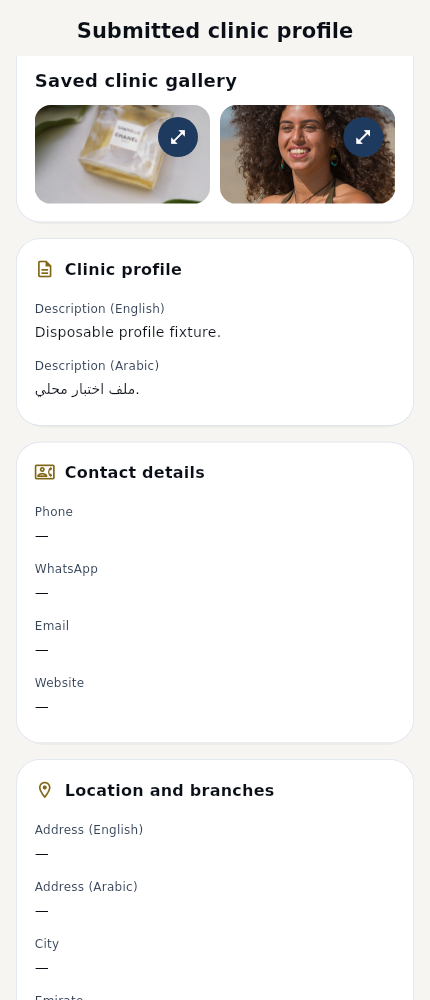
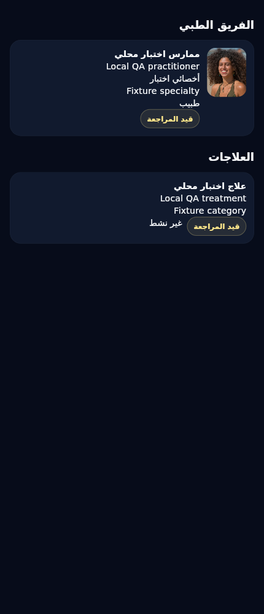
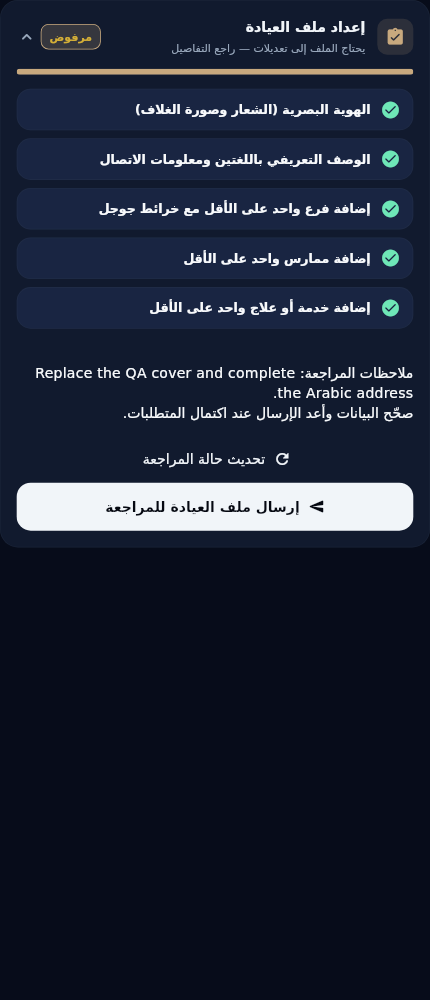

# Actual Flutter integration renders

These are actual Flutter-rendered **disposable QA fixtures**, using real decoded image files and source-confirmed DTO shapes. They do not prove production CDN delivery, a real clinic identity, physical Android playback or live entitlement. No reference artwork or fixture photography was added as production clinic content.

| Surface | Light EN | Dark EN | Light AR | Dark AR |
|---|---|---|---|---|
| review | [PNG](backend09_review_light_en.png) | [PNG](backend09_review_dark_en.png) | [PNG](backend09_review_light_ar.png) | [PNG](backend09_review_dark_ar.png) |
| gallery | [PNG](backend09_gallery_light_en.png) | [PNG](backend09_gallery_dark_en.png) | [PNG](backend09_gallery_light_ar.png) | [PNG](backend09_gallery_dark_ar.png) |
| content | [PNG](backend09_content_light_en.png) | [PNG](backend09_content_dark_en.png) | [PNG](backend09_content_light_ar.png) | [PNG](backend09_content_dark_ar.png) |
| owner_feedback | [PNG](backend09_owner_feedback_light_en.png) | [PNG](backend09_owner_feedback_dark_en.png) | [PNG](backend09_owner_feedback_light_ar.png) | [PNG](backend09_owner_feedback_dark_ar.png) |
| narrow | [PNG](backend09_narrow_light_en.png) | [PNG](backend09_narrow_dark_en.png) | [PNG](backend09_narrow_light_ar.png) | [PNG](backend09_narrow_dark_ar.png) |

Cold-service VIP captures (private tier available, unpublished clinic, saved reference reloaded):

| Setup state | Capture |
|---|---|
| draft | [PNG](backend09_vip_cold_draft.png) |
| submitted | [PNG](backend09_vip_cold_submitted.png) |
| rejected | [PNG](backend09_vip_cold_rejected.png) |

Representative source-scoped gallery and content:

The narrow cases use 320dp and 180% text scale. Treatment images/descriptions are not fabricated: the supplied backend summary has no such fields. Gallery cards expand originals with contain, and portraits use controlled bounds.

[QA report and physical checklist](../BACKEND_09F49BB_INTEGRATION_QA_REPORT.md) · [Exact PNG hashes](render-manifest.json)
