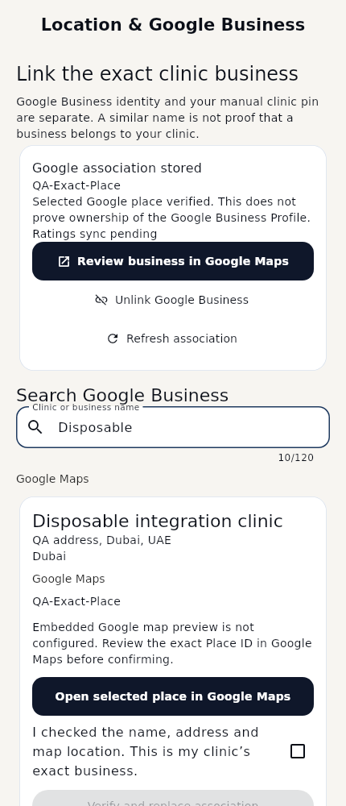

# Actual Flutter401560b integration previews

These18 screenshots are real Flutter widget renders with test fonts. Business names, IDs, addresses and OTP destinations are **disposable fixtures**, not real Google responses, production clinics or physical-device evidence. The catalog fixture is the actual public catalog from source401560b. No golden baselines were overwritten. Google/nearby placeholders are not falsely presented as a working SDK.

| Screen | Light English | Dark English | Light Arabic RTL | Dark Arabic RTL |
|---|---|---|---|---|
| Google association / enabled search | [Light EN](business_401560b_light_en.png) | [Dark EN](business_401560b_dark_en.png) | [Light AR](business_401560b_light_ar.png) | [Dark AR](business_401560b_dark_ar.png) |
| Exact Details / confirmation | [Light EN](business_details_401560b_light_en.png) | [Dark EN](business_details_401560b_dark_en.png) | [Light AR](business_details_401560b_light_ar.png) | [Dark AR](business_details_401560b_dark_ar.png) |
| Backend emirate/city/area picker | [Light EN](localities_401560b_light_en.png) | [Dark EN](localities_401560b_dark_en.png) | [Light AR](localities_401560b_light_ar.png) | [Dark AR](localities_401560b_dark_ar.png) |
| Real-shape masked OTP feedback | [Light EN](otp_destination_401560b_light_en.png) | [Dark EN](otp_destination_401560b_dark_en.png) | [Light AR](otp_destination_401560b_light_ar.png) | [Dark AR](otp_destination_401560b_dark_ar.png) |

Explicit clinic exit: [sole-admin options](sole_admin_resolution_light_en.png), [typed deactivation confirmation](clinic_deactivation_confirmation_light_en.png). The confirm button remains disabled until both the typed phrase and explicit consent are supplied. Cancellation sends no mutation.




Reviewed output includes readable source attribution, accurate selected-place-only verification wording, LTR masked destinations inside RTL text, clear deactivation consent and preserved premium portal styles. Current nearby unavailable previews remain in [the prior index](../maps-business-readiness/README.md); its future-result fixtures are historical demonstrations, not live activation. The new401560b nearby adapter remains gated because the source exposes unapproved drafts.

Reproduce:

```bash
flutter test test/backend_401560b_integration_test.dart --dart-define=ONBOARDING_REVIEW_CAPTURE_DIR=/absolute/output/path --reporter expanded
```

Native Ubuntu/Windows CI runs this test group and uploads its own evidence. See [render hashes/dimensions](render-manifest.json), [compatibility report](../BACKEND_401560B_INTEGRATION_REPORT.md), [bilingual handoff](../BACKEND_401560B_REMAINING_GAPS_FOR_ALI.md), [physical checklist](PHYSICAL_ANDROID_QA.md), [source probe](source-evidence.json), [file manifest](CHANGED_FILES.txt).
