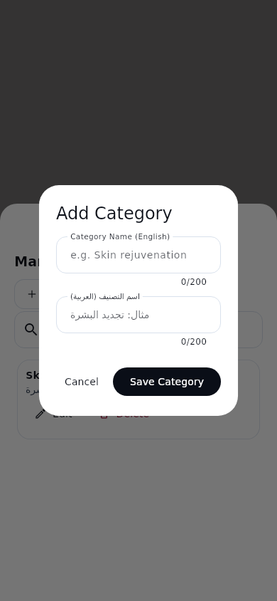
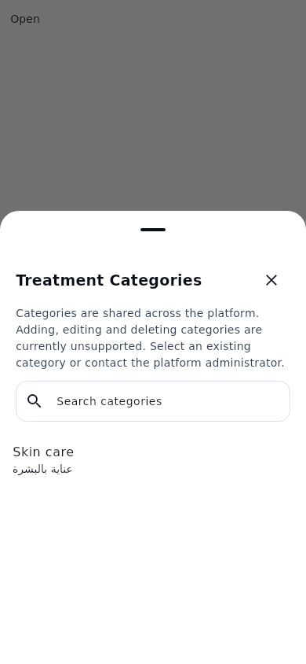
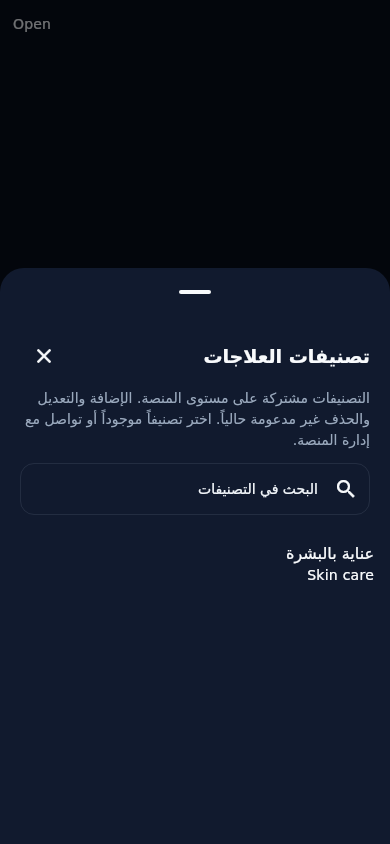
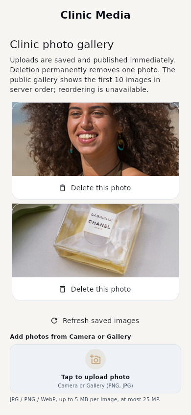
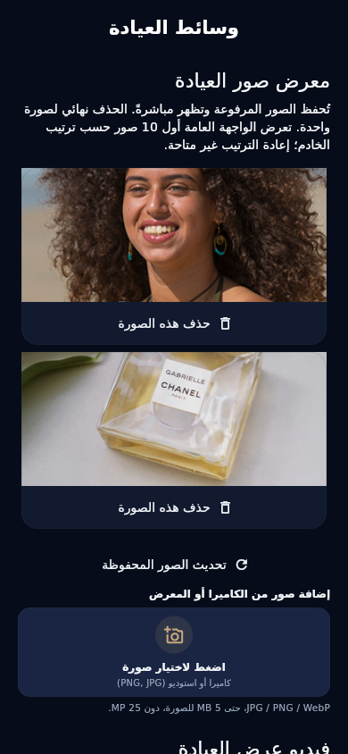
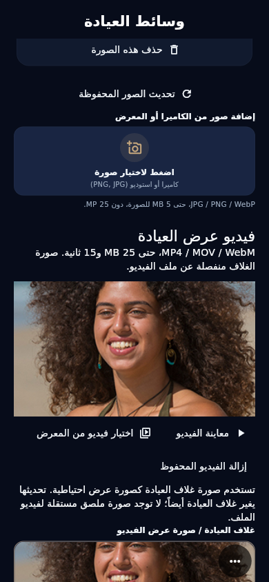

# Flutter render comparisons / مقارنات Flutter المرئية

These PNGs are actual Flutter widget renders at 390×844 logical pixels, DPR 1, Flutter 3.41.5 on Linux. They use the shared deterministic Latin/Arabic and Material icon fonts from `test/support/patient_visual_harness.dart`. Modal Directionality is applied above Navigator so Arabic sheets really exercise RTL. These are QA captures, not physical Android/iOS screenshots or screenshots of production data.

Before: detached `b402d3bf7cc46c73cc1f142c7e93c4066e92d594`, unchanged production UI, same QA category and font harness. The [before capture harness](before_capture_test.dart.fixture) can be copied to `test/clinic_audit_before_capture_test.dart` in a disposable worktree of that base; change its output directory to an existing writable local directory. It is not executed by the current suite because it intentionally targets the old category UI.

After: current remediation branch, `test/clinic_treatment_contract_test.dart` and `test/clinic_media_contract_test.dart`. Real existing licensed test photos are decoded from local files; they are not clinic content and are not added to application assets. The displayed Clinic cover is a separate image; MP4 is never used as an image. See `test/fixtures/media/README.md` and `test/fixtures/clinic_media/README.md` for provenance. Video screenshot shows the honest lazy poster before playback, not a fabricated native video decode.

## Before → after category workflow

The former enabled Add/Edit/Delete interface could never work with d1023b0. Its nested Add Category dialog is replaced by a single readable read-only search/selection sheet and explicit server limitation. An existing category UUID remains selectable. This comparison documents removal of unsupported operations, **not working category CRUD**.

| Theme / language | Before directory | Before nested Add | After safe directory | Keyboard-inset layout | Treatment editor |
|---|---|---|---|---|---|
| light / EN | [Before](before_categories_light_en.png) | [Unsupported Add](before_category_dialog_light_en.png) | [After](after_categories_light_en.png) | [Inset](after_categories_keyboard_light_en.png) | [Editor](after_treatment_light_en.png) |
| light / AR | [Before](before_categories_light_ar.png) | [Unsupported Add](before_category_dialog_light_ar.png) | [After](after_categories_light_ar.png) | [Inset](after_categories_keyboard_light_ar.png) | [Editor](after_treatment_light_ar.png) |
| dark / EN | [Before](before_categories_dark_en.png) | [Unsupported Add](before_category_dialog_dark_en.png) | [After](after_categories_dark_en.png) | [Inset](after_categories_keyboard_dark_en.png) | [Editor](after_treatment_dark_en.png) |
| dark / AR | [Before](before_categories_dark_ar.png) | [Unsupported Add](before_category_dialog_dark_ar.png) | [After](after_categories_dark_ar.png) | [Inset](after_categories_keyboard_dark_ar.png) | [Editor](after_treatment_dark_ar.png) |

Keyboard captures reserve a 280px view inset and assert scrolling without overflow. Flutter widget tests do not draw the operating-system keyboard; the reserved area is intentional, not a claim of native IME verification. Treatment editors are scrollable and preserve decimal price, category and practitioner IDs; large empty lower areas in these constrained QA compositions are outside the content viewport, not added media containers.

| Before Light EN | After Light EN | After Dark AR / RTL |
|---|---|---|
|  |  |  |

## New supported media workflows

No previous Clinic Portal multi-image gallery or native profile-video editor existed; there is no invented “before” media screenshot. The new gallery displays two actual decoded QA files without replacing one with the other, and exposes individual delete and native multi-select actions. The video section keeps the cover/image separate and truthfully explains the absent independent poster field.

| Theme / language | Multi-image gallery | Supported profile video + separate cover |
|---|---|---|
| light / EN | [Gallery](gallery_light_en.png) | [Video editor](showcase_video_light_en.png) |
| light / AR | [Gallery](gallery_light_ar.png) | [Video editor](showcase_video_light_ar.png) |
| dark / EN | [Gallery](gallery_dark_en.png) | [Video editor](showcase_video_dark_en.png) |
| dark / AR | [Gallery](gallery_dark_ar.png) | [Video editor](showcase_video_dark_ar.png) |

| Multi-image Light EN | Multi-image Dark AR / RTL | Video Dark AR / RTL |
|---|---|---|
|  |  |  |

Review: category text remains readable in both themes; no broken write dialog; true Arabic RTL placement, scrollable sheet under keyboard insets; both gallery image frames genuinely decode; deletion identifies one photo; media limits and immediate publication are visible; video controls operate independently from the cover. Approved Patient designs and existing goldens are unchanged.

**العرض المرئي من Flutter حقيقي، والبيانات صور اختبار مرخصة وليست عيادات حقيقية.** تمت مراجعة اللغتين والثيمين واتجاه النوافذ RTL. تصوير المساحة المحجوزة للوحة المفاتيح ليس تصوير لوحة مفاتيح أندرويد حقيقية. صور الفيديو تعرض الغلاف قبل التشغيل لتوضيح الفصل بين ملف الصورة والفيديو. التحقق من R2 وإعادة تشغيل جهاز فعلي ما زال مطلوباً.

Reproduce after captures:

```sh
flutter test test/clinic_media_contract_test.dart test/clinic_treatment_contract_test.dart \
  --dart-define=CLINIC_AUDIT_CAPTURE_DIR=docs/clinic-portal-audit --reporter expanded
```

The existing Ubuntu/Windows CI workflow also runs these tests and captures review PNG artifacts; it does not replace or relax Patient golden comparisons.
