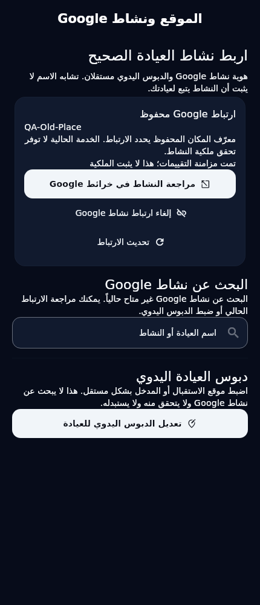
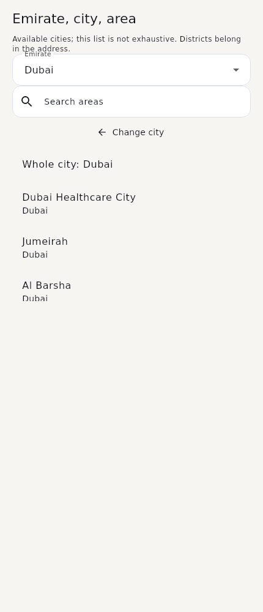

# Actual Flutter renders — Google Business and localities

These are actual Flutter widget renders with bundled test fonts. Names, addresses, Place IDs, proofs, branches and distances are **disposable test fixtures**, not production clinics, Google responses or live nearest results. No Google SDK/key/tiles or provider requests were used to create these screenshots. The unconfigured embedded-map state is deliberate; no fake Google map was rendered.

| Component / state | Light EN | Dark EN | Light Arabic RTL | Dark Arabic RTL |
|---|---|---|---|---|
| Stored association, search unavailable | [Light EN](google_association_light_en.png) | [Dark EN](google_association_dark_en.png) | [Light RTL](google_association_light_ar.png) | [Dark RTL](google_association_dark_ar.png) |
| Future selected-result preview, explicit confirmation | [Light EN](google_selection_light_en.png) | [Dark EN](google_selection_dark_en.png) | [Light RTL](google_selection_light_ar.png) | [Dark RTL](google_selection_dark_ar.png) |
| Emirate → city → area | [Light EN](locality_areas_light_en.png) | [Dark EN](locality_areas_dark_en.png) | [Light RTL](locality_areas_light_ar.png) | [Dark RTL](locality_areas_dark_ar.png) |
| Current nearby map/list unavailable | [Light EN](nearby_unavailable_light_en.png) | [Dark EN](nearby_unavailable_dark_en.png) | [Light RTL](nearby_unavailable_light_ar.png) | [Dark RTL](nearby_unavailable_dark_ar.png) |

Additional captures: [320dp/180% English](google_scaled_en.png), [320dp/180% Arabic](google_scaled_ar.png), [future adapter with explicit fixture server distance](nearby_fixture_server_distance.png).





The selected-result render is an injected test repository with no HTTP adapter. It demonstrates Place-ID selection, address/locality and a disabled confirmation until the user checks identity; it does not establish that live search/verification is deployed. The default production repository cannot autocomplete or link non-empty IDs.

Current association review and clear use source-confirmed existing profile GET/PATCH, with fresh-read verification. Their source evidence is [here](source-evidence.json). Google sync and business verification are displayed separately. The map/list route is reachable from Home; bottom navigation remains the original five destinations.

Reproduce:

```bash
flutter test test/google_business_readiness_test.dart test/nearby_locality_readiness_test.dart --dart-define=ONBOARDING_REVIEW_CAPTURE_DIR=/absolute/path/output --reporter expanded
```

No old golden baselines were overwritten. Native Windows/Ubuntu CI uploads its own captures. [Hashes/dimensions](render-manifest.json), [QA report](../GOOGLE_BUSINESS_LOCALITY_NEARBY_REPORT.md), [bilingual missing contracts](../GOOGLE_BUSINESS_LOCALITY_NEARBY_BACKEND_HANDOFF_FOR_ALI.md).
