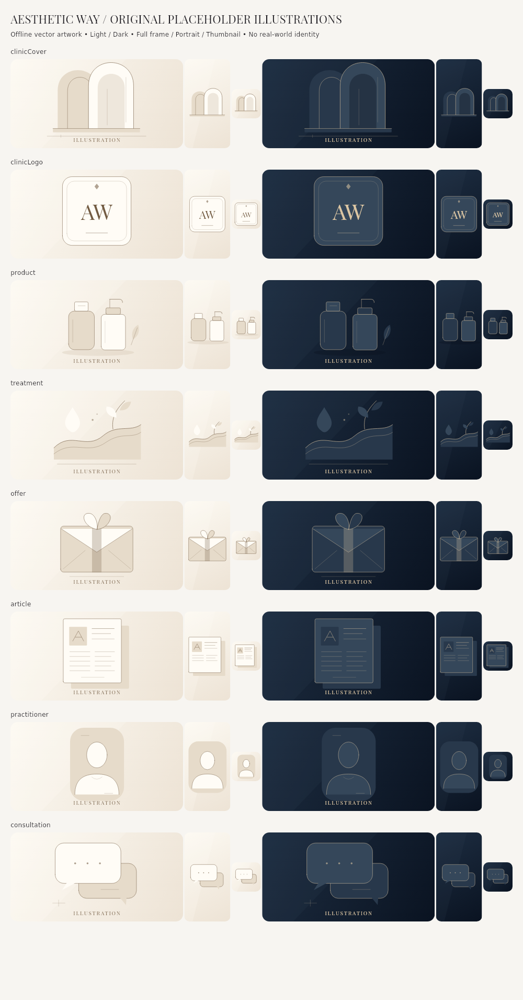

# Category artwork: Flutter review evidence

Actual Flutter renders, not generated UI mockups. Sample records, photographs and Google aggregates belong to test fixtures. They do not prove live production delivery. Missing-source and corrupt-file states are produced through actual production widgets; valid photographs decode real pixels.

## Complete placeholder family



[Asset inventory: purpose, formats and actual byte sizes](asset_inventory.json) · [Capture manifest and source hashes](capture_manifest.json)

## Before / after comparisons

Four columns: **old monogram fallback / new missing-source illustration / genuine decode failure / genuine decoded fixture photo**. Widths are logical dp. Total card height may vary with genuine metadata; media geometry remains consumer-owned. The failed-source column is visibly labelled in the artwork where space allows, with a distinct accessible label at all sizes.

| Screen | 390px Light EN | 390px Dark EN | 390px Light AR | 390px Dark AR | Narrow 320px |
| --- | --- | --- | --- | --- | --- |
| home | [light_en](comparisons/home_light_en.jpg) | [dark_en](comparisons/home_dark_en.jpg) | [light_ar](comparisons/home_light_ar.jpg) | [dark_ar](comparisons/home_dark_ar.jpg) | [light_en](comparisons/home_light_en_w320.jpg) · [dark_en](comparisons/home_dark_en_w320.jpg) · [light_ar](comparisons/home_light_ar_w320.jpg) · [dark_ar](comparisons/home_dark_ar_w320.jpg) |
| directory | [light_en](comparisons/directory_light_en.jpg) | [dark_en](comparisons/directory_dark_en.jpg) | [light_ar](comparisons/directory_light_ar.jpg) | [dark_ar](comparisons/directory_dark_ar.jpg) | [light_en](comparisons/directory_light_en_w320.jpg) · [dark_en](comparisons/directory_dark_en_w320.jpg) · [light_ar](comparisons/directory_light_ar_w320.jpg) · [dark_ar](comparisons/directory_dark_ar_w320.jpg) |
| clinic | [light_en](comparisons/clinic_light_en.jpg) | [dark_en](comparisons/clinic_dark_en.jpg) | [light_ar](comparisons/clinic_light_ar.jpg) | [dark_ar](comparisons/clinic_dark_ar.jpg) | [light_en](comparisons/clinic_light_en_w320.jpg) · [dark_en](comparisons/clinic_dark_en_w320.jpg) · [light_ar](comparisons/clinic_light_ar_w320.jpg) · [dark_ar](comparisons/clinic_dark_ar_w320.jpg) |
| products | [light_en](comparisons/products_light_en.jpg) | [dark_en](comparisons/products_dark_en.jpg) | [light_ar](comparisons/products_light_ar.jpg) | [dark_ar](comparisons/products_dark_ar.jpg) | [light_en](comparisons/products_light_en_w320.jpg) · [dark_en](comparisons/products_dark_en_w320.jpg) · [light_ar](comparisons/products_light_ar_w320.jpg) · [dark_ar](comparisons/products_dark_ar_w320.jpg) |
| treatments | [light_en](comparisons/treatments_light_en.jpg) | [dark_en](comparisons/treatments_dark_en.jpg) | [light_ar](comparisons/treatments_light_ar.jpg) | [dark_ar](comparisons/treatments_dark_ar.jpg) | [light_en](comparisons/treatments_light_en_w320.jpg) · [dark_en](comparisons/treatments_dark_en_w320.jpg) · [light_ar](comparisons/treatments_light_ar_w320.jpg) · [dark_ar](comparisons/treatments_dark_ar_w320.jpg) |
| offers | [light_en](comparisons/offers_light_en.jpg) | [dark_en](comparisons/offers_dark_en.jpg) | [light_ar](comparisons/offers_light_ar.jpg) | [dark_ar](comparisons/offers_dark_ar.jpg) | [light_en](comparisons/offers_light_en_w320.jpg) · [dark_en](comparisons/offers_dark_en_w320.jpg) · [light_ar](comparisons/offers_light_ar_w320.jpg) · [dark_ar](comparisons/offers_dark_ar_w320.jpg) |
| articles | [light_en](comparisons/articles_light_en.jpg) | [dark_en](comparisons/articles_dark_en.jpg) | [light_ar](comparisons/articles_light_ar.jpg) | [dark_ar](comparisons/articles_dark_ar.jpg) | [light_en](comparisons/articles_light_en_w320.jpg) · [dark_en](comparisons/articles_dark_en_w320.jpg) · [light_ar](comparisons/articles_light_ar_w320.jpg) · [dark_ar](comparisons/articles_dark_ar_w320.jpg) |
| practitioners | [light_en](comparisons/practitioners_light_en.jpg) | [dark_en](comparisons/practitioners_dark_en.jpg) | [light_ar](comparisons/practitioners_light_ar.jpg) | [dark_ar](comparisons/practitioners_dark_ar.jpg) | [light_en](comparisons/practitioners_light_en_w320.jpg) · [dark_en](comparisons/practitioners_dark_en_w320.jpg) · [light_ar](comparisons/practitioners_light_ar_w320.jpg) · [dark_ar](comparisons/practitioners_dark_ar_w320.jpg) |
| consultation | [light_en](comparisons/consultation_light_en.jpg) | [dark_en](comparisons/consultation_dark_en.jpg) | [light_ar](comparisons/consultation_light_ar.jpg) | [dark_ar](comparisons/consultation_dark_ar.jpg) | [light_en](comparisons/consultation_light_en_w320.jpg) · [dark_en](comparisons/consultation_dark_en_w320.jpg) · [light_ar](comparisons/consultation_light_ar_w320.jpg) · [dark_ar](comparisons/consultation_dark_ar_w320.jpg) |
| clinic_staff | [light_en](comparisons/clinic_staff_light_en.jpg) | [dark_en](comparisons/clinic_staff_dark_en.jpg) | [light_ar](comparisons/clinic_staff_light_ar.jpg) | [dark_ar](comparisons/clinic_staff_dark_ar.jpg) | [light_en](comparisons/clinic_staff_light_en_w320.jpg) · [dark_en](comparisons/clinic_staff_dark_en_w320.jpg) · [light_ar](comparisons/clinic_staff_light_ar_w320.jpg) · [dark_ar](comparisons/clinic_staff_dark_ar_w320.jpg) |
| clinic_treatments | [light_en](comparisons/clinic_treatments_light_en.jpg) | [dark_en](comparisons/clinic_treatments_dark_en.jpg) | [light_ar](comparisons/clinic_treatments_light_ar.jpg) | [dark_ar](comparisons/clinic_treatments_dark_ar.jpg) | [light_en](comparisons/clinic_treatments_light_en_w320.jpg) · [dark_en](comparisons/clinic_treatments_dark_en_w320.jpg) · [light_ar](comparisons/clinic_treatments_light_ar_w320.jpg) · [dark_ar](comparisons/clinic_treatments_dark_ar_w320.jpg) |
| clinic_offers | [light_en](comparisons/clinic_offers_light_en.jpg) | [dark_en](comparisons/clinic_offers_dark_en.jpg) | [light_ar](comparisons/clinic_offers_light_ar.jpg) | [dark_ar](comparisons/clinic_offers_dark_ar.jpg) | [light_en](comparisons/clinic_offers_light_en_w320.jpg) · [dark_en](comparisons/clinic_offers_dark_en_w320.jpg) · [light_ar](comparisons/clinic_offers_light_ar_w320.jpg) · [dark_ar](comparisons/clinic_offers_dark_ar_w320.jpg) |

## Full-size after frames

| Screen | Light EN | Dark EN | Light Arabic RTL | Dark Arabic RTL |
| --- | --- | --- | --- | --- |
| home | [media](after/home_media_light_en.png) · [absent](after/home_absent_light_en.png) · [failed](after/home_failed_light_en.png) | [media](after/home_media_dark_en.png) · [absent](after/home_absent_dark_en.png) · [failed](after/home_failed_dark_en.png) | [media](after/home_media_light_ar.png) · [absent](after/home_absent_light_ar.png) · [failed](after/home_failed_light_ar.png) | [media](after/home_media_dark_ar.png) · [absent](after/home_absent_dark_ar.png) · [failed](after/home_failed_dark_ar.png) |
| directory | [media](after/directory_media_light_en.png) · [absent](after/directory_absent_light_en.png) · [failed](after/directory_failed_light_en.png) | [media](after/directory_media_dark_en.png) · [absent](after/directory_absent_dark_en.png) · [failed](after/directory_failed_dark_en.png) | [media](after/directory_media_light_ar.png) · [absent](after/directory_absent_light_ar.png) · [failed](after/directory_failed_light_ar.png) | [media](after/directory_media_dark_ar.png) · [absent](after/directory_absent_dark_ar.png) · [failed](after/directory_failed_dark_ar.png) |
| clinic | [media](after/clinic_media_light_en.png) · [absent](after/clinic_absent_light_en.png) · [failed](after/clinic_failed_light_en.png) | [media](after/clinic_media_dark_en.png) · [absent](after/clinic_absent_dark_en.png) · [failed](after/clinic_failed_dark_en.png) | [media](after/clinic_media_light_ar.png) · [absent](after/clinic_absent_light_ar.png) · [failed](after/clinic_failed_light_ar.png) | [media](after/clinic_media_dark_ar.png) · [absent](after/clinic_absent_dark_ar.png) · [failed](after/clinic_failed_dark_ar.png) |
| products | [media](after/products_media_light_en.png) · [absent](after/products_absent_light_en.png) · [failed](after/products_failed_light_en.png) | [media](after/products_media_dark_en.png) · [absent](after/products_absent_dark_en.png) · [failed](after/products_failed_dark_en.png) | [media](after/products_media_light_ar.png) · [absent](after/products_absent_light_ar.png) · [failed](after/products_failed_light_ar.png) | [media](after/products_media_dark_ar.png) · [absent](after/products_absent_dark_ar.png) · [failed](after/products_failed_dark_ar.png) |
| treatments | [media](after/treatments_media_light_en.png) · [absent](after/treatments_absent_light_en.png) · [failed](after/treatments_failed_light_en.png) | [media](after/treatments_media_dark_en.png) · [absent](after/treatments_absent_dark_en.png) · [failed](after/treatments_failed_dark_en.png) | [media](after/treatments_media_light_ar.png) · [absent](after/treatments_absent_light_ar.png) · [failed](after/treatments_failed_light_ar.png) | [media](after/treatments_media_dark_ar.png) · [absent](after/treatments_absent_dark_ar.png) · [failed](after/treatments_failed_dark_ar.png) |
| offers | [media](after/offers_media_light_en.png) · [absent](after/offers_absent_light_en.png) · [failed](after/offers_failed_light_en.png) | [media](after/offers_media_dark_en.png) · [absent](after/offers_absent_dark_en.png) · [failed](after/offers_failed_dark_en.png) | [media](after/offers_media_light_ar.png) · [absent](after/offers_absent_light_ar.png) · [failed](after/offers_failed_light_ar.png) | [media](after/offers_media_dark_ar.png) · [absent](after/offers_absent_dark_ar.png) · [failed](after/offers_failed_dark_ar.png) |
| articles | [media](after/articles_media_light_en.png) · [absent](after/articles_absent_light_en.png) · [failed](after/articles_failed_light_en.png) | [media](after/articles_media_dark_en.png) · [absent](after/articles_absent_dark_en.png) · [failed](after/articles_failed_dark_en.png) | [media](after/articles_media_light_ar.png) · [absent](after/articles_absent_light_ar.png) · [failed](after/articles_failed_light_ar.png) | [media](after/articles_media_dark_ar.png) · [absent](after/articles_absent_dark_ar.png) · [failed](after/articles_failed_dark_ar.png) |
| practitioners | [media](after/practitioners_media_light_en.png) · [absent](after/practitioners_absent_light_en.png) · [failed](after/practitioners_failed_light_en.png) | [media](after/practitioners_media_dark_en.png) · [absent](after/practitioners_absent_dark_en.png) · [failed](after/practitioners_failed_dark_en.png) | [media](after/practitioners_media_light_ar.png) · [absent](after/practitioners_absent_light_ar.png) · [failed](after/practitioners_failed_light_ar.png) | [media](after/practitioners_media_dark_ar.png) · [absent](after/practitioners_absent_dark_ar.png) · [failed](after/practitioners_failed_dark_ar.png) |
| consultation | [media](after/consultation_media_light_en.png) · [absent](after/consultation_absent_light_en.png) · [failed](after/consultation_failed_light_en.png) | [media](after/consultation_media_dark_en.png) · [absent](after/consultation_absent_dark_en.png) · [failed](after/consultation_failed_dark_en.png) | [media](after/consultation_media_light_ar.png) · [absent](after/consultation_absent_light_ar.png) · [failed](after/consultation_failed_light_ar.png) | [media](after/consultation_media_dark_ar.png) · [absent](after/consultation_absent_dark_ar.png) · [failed](after/consultation_failed_dark_ar.png) |
| clinic_staff | [media](after/clinic_staff_media_light_en.png) · [absent](after/clinic_staff_absent_light_en.png) · [failed](after/clinic_staff_failed_light_en.png) | [media](after/clinic_staff_media_dark_en.png) · [absent](after/clinic_staff_absent_dark_en.png) · [failed](after/clinic_staff_failed_dark_en.png) | [media](after/clinic_staff_media_light_ar.png) · [absent](after/clinic_staff_absent_light_ar.png) · [failed](after/clinic_staff_failed_light_ar.png) | [media](after/clinic_staff_media_dark_ar.png) · [absent](after/clinic_staff_absent_dark_ar.png) · [failed](after/clinic_staff_failed_dark_ar.png) |
| clinic_treatments | [media](after/clinic_treatments_media_light_en.png) · [absent](after/clinic_treatments_absent_light_en.png) · [failed](after/clinic_treatments_failed_light_en.png) | [media](after/clinic_treatments_media_dark_en.png) · [absent](after/clinic_treatments_absent_dark_en.png) · [failed](after/clinic_treatments_failed_dark_en.png) | [media](after/clinic_treatments_media_light_ar.png) · [absent](after/clinic_treatments_absent_light_ar.png) · [failed](after/clinic_treatments_failed_light_ar.png) | [media](after/clinic_treatments_media_dark_ar.png) · [absent](after/clinic_treatments_absent_dark_ar.png) · [failed](after/clinic_treatments_failed_dark_ar.png) |
| clinic_offers | [media](after/clinic_offers_media_light_en.png) · [absent](after/clinic_offers_absent_light_en.png) · [failed](after/clinic_offers_failed_light_en.png) | [media](after/clinic_offers_media_dark_en.png) · [absent](after/clinic_offers_absent_dark_en.png) · [failed](after/clinic_offers_failed_dark_en.png) | [media](after/clinic_offers_media_light_ar.png) · [absent](after/clinic_offers_absent_light_ar.png) · [failed](after/clinic_offers_failed_light_ar.png) | [media](after/clinic_offers_media_dark_ar.png) · [absent](after/clinic_offers_absent_dark_ar.png) · [failed](after/clinic_offers_failed_dark_ar.png) |

Every corresponding `_w320.png` exists in [after](after). Scrolled Home, Clinic and Consultation frames use `_scrolled.png`; these show the content below the retained hero. Original missing-source frames are in [before](before). No reference photo is substituted for a missing production record.

## Hydrated splash renders

The tests assert the first application frame **before** these animated splash captures. These are Flutter frames, not native Android screenshots or physical-device evidence.

- [splash_ar_dark](startup/splash_ar_dark.png)

- [splash_ar_light](startup/splash_ar_light.png)

- [splash_en_dark](startup/splash_en_dark.png)

- [splash_en_light](startup/splash_en_light.png)

[Engineering report, integration files and exact physical-device verification steps](../PATIENT_FINAL_PLACEHOLDERS_AND_PREFERENCES_REPORT.md). Native golden provenance is recorded separately; Linux-hosted Android-target renders do not establish native Windows, Android device or iOS acceptance.

## Reproduce review captures

Use Flutter 3.41.5 and an empty review output directory. These commands write review candidates via the explicit output defines, rather than replacing approved host baselines:

```sh
flutter test test/media_first_previews_test.dart --update-goldens --dart-define=PREMIUM_PLACEHOLDER_REVIEW=true --dart-define=MEDIA_FIRST_CAPTURE_DIR=/absolute/path/to/review/screens
flutter test test/patient_portal_visual_test.dart test/patient_media_family_test.dart --name 'Clinic profile golden|complete original vector family' --update-goldens --dart-define=PATIENT_GOLDEN_CAPTURE_DIR=/absolute/path/to/review/native --dart-define=PATIENT_FAMILY_CAPTURE_DIR=/absolute/path/to/review/native
flutter test test/patient_startup_preferences_test.dart --update-goldens --dart-define=PATIENT_STARTUP_CAPTURE_DIR=/absolute/path/to/review/startup
```

Before renders use the approved baseline commit with the same review matrix and fixture data, not an older design archive; before/after harness hashes are recorded separately. The contact sheet shows 48 actual Flutter panels: eight categories × two themes × three frame classes. Native candidate adoption always requires visual and shared-geometry review.

## Native Windows review

- [All-category native Windows family](native-windows-family.png)
- [Four native Windows clinic variants](native-windows-clinic-review.jpg)

All five rasters were visually reviewed before adoption. All four clinic geometry/style JSON files exactly match Linux. The initial Windows probe exposed fixture path/lifetime issues and missing new baselines; final PR-head CI validates the corrected fixtures and exact raster comparisons.

## Verified native validation

[Run 39755812602](https://github.com/majd-khalifa/AestheticWay/actions/runs/39755812602) passed for code commit `cdc0e11f445ebd2b7a3baf770eae98346e80ea61` on native Ubuntu 24.04 and Windows Server 2022: **737 full tests, 291 focused tests and analyzer zero issues on each host**. Both also passed all nine native capture cases, and Windows passed the offline privacy check. This does not establish physical Android/iOS cold launches or live production data delivery. See the report for exact manual steps.
