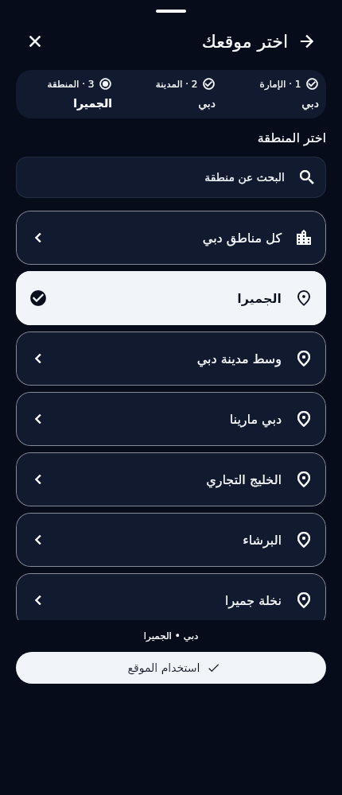

# Physical-QA remediation — actual Flutter renders

These are **22 actual Flutter-rendered screenshots**, not physical-device screenshots or production Google/R2 evidence. Before and after location captures use the same430×1000/DPR1 viewport, English/Arabic test fonts, source401560b catalog and saved Dubai/Jumeirah selection. “Before” was rendered from an isolated checkout of commit `32498e331f972fa0a036c46d98d39bd78c1207fe`; its disposable capture harness is retained below. After renders show the implemented shared picker. No genuine clinic/practitioner photo or generated reference artwork was substituted.

| Mode | City: before → after | Area: before → after |
|---|---|---|
| Light English | [Before](location_before_city_light_en.png) → [After](location_after_city_light_en.png) | [Before](location_before_area_light_en.png) → [After](location_after_area_light_en.png) |
| Dark English | [Before](location_before_city_dark_en.png) → [After](location_after_city_dark_en.png) | [Before](location_before_area_dark_en.png) → [After](location_after_area_dark_en.png) |
| Light Arabic RTL | [Before](location_before_city_light_ar.png) → [After](location_after_city_light_ar.png) | [Before](location_before_area_light_ar.png) → [After](location_after_area_light_ar.png) |
| Dark Arabic RTL | [Before](location_before_city_dark_ar.png) → [After](location_after_city_dark_ar.png) | [Before](location_before_area_dark_ar.png) → [After](location_after_area_dark_ar.png) |

Additional accessibility renders: [320dp /180% English](location_scaled_en.png), [320dp /180% Arabic](location_scaled_ar.png). The catalog is source-backed; labels/codes are never invented. Cards retain selected checkmarks, a visible path, parent-change reset, explicit confirmation and a pinned footer; short city lists use a compact sheet instead of a large empty region.

HTTP500 video-save failure: [Light English](video_upload_http500_light_en.png), [Dark English](video_upload_http500_dark_en.png), [Light Arabic](video_upload_http500_light_ar.png), [Dark Arabic](video_upload_http500_dark_ar.png). These use the real two-second neutral MP4 test file and a **fake native player / injected HTTP500**, to verify placement, selection preservation, duplicate guards and honest feedback. They do not establish native video decoding, remote persistence, real server failure cause or physical playback. Local selection is explicitly marked unconfirmed and repeat upload is blocked until verification.



The existing Google association/Details and OTP destination renders remain in [the preceding integration index](../backend-401560b-qa/README.md); they are also disposable fixtures, not live-provider evidence.

Reproduce after renders:

```bash
flutter test test/physical_qa_location_polish_test.dart test/video_save_qa_preview_test.dart --dart-define=ONBOARDING_REVIEW_CAPTURE_DIR=/absolute/output --reporter expanded
```

To reproduce before: use a separate checkout of32498e3, copy [the baseline capture harness](baseline_capture_test.dart.txt) to its `test/physical_qa_before_capture_test.dart`, then run it with the same capture define. No baseline widget implementation or historical test is changed in the current application. Before capture:4 tests passed.

[Hashes/dimensions](render-manifest.json) · [change report](../FINAL_PHYSICAL_QA_REMEDIATION_REPORT.md) · [single remaining-backend handoff](../FINAL_PHYSICAL_QA_REMAINING_BACKEND_HANDOFF_FOR_ALI.md) · [Maps readiness](../GOOGLE_MAPS_PRODUCTION_READINESS_PLAN.md) · [changed-file manifest](CHANGED_FILES.txt)
