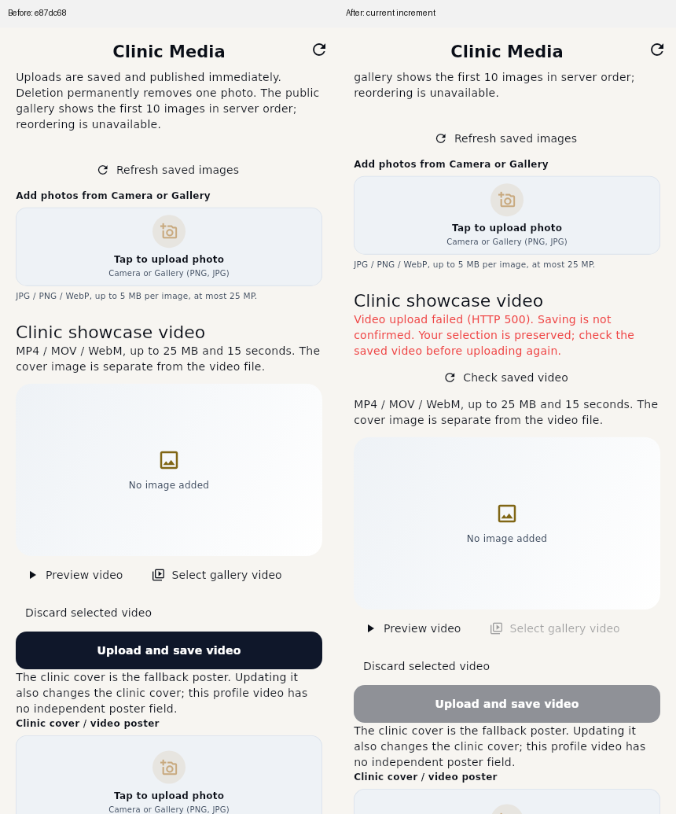
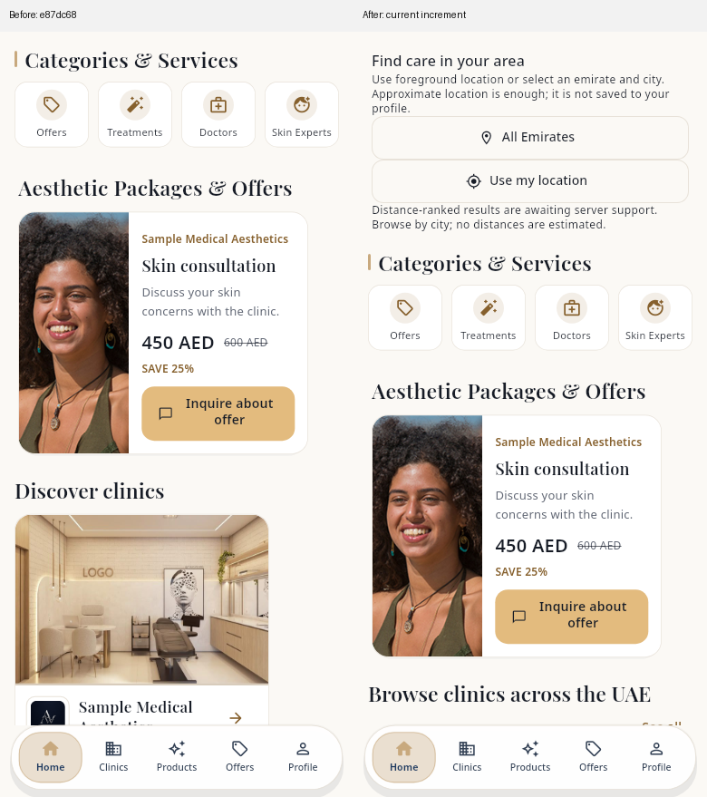
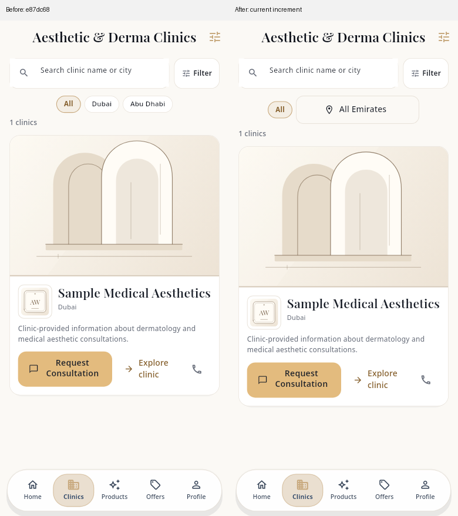

# Actual Flutter QA renders

All screenshots are Flutter-rendered widget trees at logical pixel scale1 using bundled test fonts/actual image decoding. These are sanitized disposable QA fixtures, **not live clinic/R2 content or physical Android evidence**. Synthetic HTTP500 exercises the reported *video save* action; it is not evidence the live server returned500.

Before: separate untouched worktree at`e87dc682e2a8eff5d8f2cc3dca926b5848569428`. After: this PR13 increment. Before/after use the same fixture and viewport. `comparison_*` files place the two unchanged renders side by side with provenance headings; source PNGs are preserved. No existing owned goldens were overwritten. Clinic profile and all previous Patient design goldens remain unchanged.

| Review | Before | After |
|---|---|---|
| Home Light EN | [top](before_home_media_light_en.png), [scrolled](before_home_media_light_en_scrolled.png) | [top](after_home_media_light_en.png), [scrolled](after_home_media_light_en_scrolled.png) |
| Home Dark Arabic RTL | [top](before_home_media_dark_ar.png), [scrolled](before_home_media_dark_ar_scrolled.png) | [top](after_home_media_dark_ar.png), [scrolled](after_home_media_dark_ar_scrolled.png) |
| Directory Light EN, missing media | [before](before_directory_absent_light_en.png) | [after](after_directory_absent_light_en.png) |
| Video upload500 Light | [before](before_video_upload_http500_light.png) | [after](after_video_upload_http500_light.png) |
| Video upload500 Dark | [before](before_video_upload_http500_dark.png) | [after](after_video_upload_http500_dark.png) |

The old video error is above the gallery and scrolls away from the video heading; the new message stays beside video controls, says upload failed with safeHTTP status, and keeps the selection. The gallery is not blamed. The after state requires a read-only check before any ambiguous upload is repeated.







| New controls/state | Light | Dark |
|---|---|---|
| Foreground/manual rationale EN | [Light EN](geo_home_panel_light_en.png) | [Dark EN](geo_home_panel_dark_en.png) |
| Foreground/manual rationale Arabic | [Light RTL](geo_home_panel_light_ar.png) | [Dark RTL](geo_home_panel_dark_ar.png) |
| Emirate→city picker EN | [Light EN](geo_picker_light_en.png) | [Dark EN](geo_picker_dark_en.png) |
| Emirate→city picker Arabic | [Light RTL](geo_picker_light_ar.png) | [Dark RTL](geo_picker_dark_ar.png) |

Accessibility: [320dp /180% English](geo_scaled_en.png), [320dp /180% Arabic RTL](geo_scaled_ar.png). The picker also has a regression for keyboard+large-text scrolling.

Other actual after renders: [PATCH accepted but fresh GET lacks video](video_save_persistence_failure.png), [OTP channel/destination genuinely absent](deletion_destination_unknown.png). Component-only renders include blank page space because they isolate the actual component, not because Home contains an empty container.

The city catalog is explicitly a partial compatibility seed pending Ali's reviewed canonical source. Current backend is tier-first: Home says browse, not nearest. No fake kilometres, device coordinates, subscription information or production identities are painted in these captures.

Reproduce after captures:

```bash
flutter test test/uae_location_qa_test.dart test/admin_media_polish_test.dart test/video_save_qa_preview_test.dart --dart-define=ONBOARDING_REVIEW_CAPTURE_DIR=/absolute/path/out --reporter expanded
flutter test test/media_first_previews_test.dart --name 'home_media_light_en|home_media_dark_ar|directory_absent_light_en' --update-goldens --dart-define=MEDIA_FIRST_CAPTURE_DIR=/absolute/path/new-candidate-output --reporter expanded
```

The second command intentionally writes **new external capture candidates**, not repository baselines. Native Windows/Ubuntu CI records its own renderer provenance and uploads renders. See [render hashes/dimensions](render-manifest.json), [11 source probes](source-evidence.json), [full report](../UAE_NEARBY_QA_REPORT.md), and [bilingual backend handoff](../UAE_NEARBY_QA_BACKEND_HANDOFF_FOR_ALI.md).
